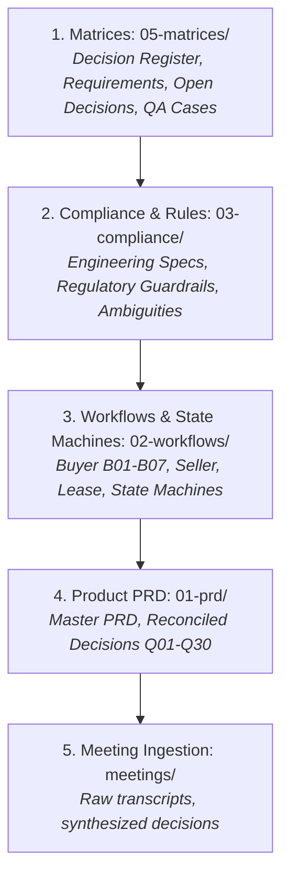

# BROKO Transaction Management — Deterministic Agent Skill

This skill enforces deterministic, source-backed behavior across all AI agents and team members working on **BROKO (@retracct)**. It ensures that regardless of which AI assistant is used (Antigravity, Claude, Copilot, Cursor, Codex), responses, task implementations, and technical decisions remain consistent with Ontario residential real estate regulations and the v3.0 architecture.

---

## 1. Non-Negotiable Operational Boundaries

Every agent answering queries or writing code for BROKO must respect these boundaries:

1. **Jurisdiction & Scope:**
   - **Ontario Residential ONLY:** Freehold Resale, Condominium Resale, POTL, Builder/Assignment, and Residential Tenancy.
   - **EXCLUDED from Scope:** Commercial real estate, general brokerage CRM lead-gen, trust general ledger accounting / monthly reconciliations, commission disbursement calculations, and SaaS tenant billing.
2. **First Engineering Deliverable:**
   - **Sprint 1 Focus:** **Buyer Freehold Resale (`B01`)** end-to-end (onboarding, representation, Form 100 offer drafting, signing, deposit tracking, condition fulfillment, and TCS export).
3. **Source Fidelity & No Invention Rule:**
   - **Never invent** legal requirements, statutory timeframes, or OREA form numbers.
   - If an OREA form version is unverified, apply **Ambiguity A-01 / Decision Q12**: show a persistent warning banner + notify BOR, but do **not** block agent drafting, and **never** falsely mark it as legally compliant.
4. **No Automated Final Legal Determinations (`Q14`, `Q19`):**
   - The platform never autonomously terminates a contract on a missed condition deadline; it transitions the condition to `EXPIRED_UNRESOLVED` and alerts humans.
   - AI clause generation is strictly a suggestion proposal; it requires human agent confirmation before insertion into Schedule A.
5. **Data Privacy & AI Model Boundary (`Q26`, `TM-020`):**
   - Client identity documents (driver's licenses, passports, SIN numbers) and confidential financial records must never be transmitted to external unapproved LLM models.

---

## 2. Canonical Knowledge Hierarchy

When answering questions or making architectural decisions, always resolve facts using this priority order:



* **Matrix Lookup File:** [`retracct/05-matrices/decision-register.md`](file:///Users/thrilok/Documents/OpenKnowledge/Broko/retracct/05-matrices/decision-register.md)
* **Requirements File:** [`retracct/05-matrices/requirements-matrix.md`](file:///Users/thrilok/Documents/OpenKnowledge/Broko/retracct/05-matrices/requirements-matrix.md)
* **Ambiguities File:** [`retracct/03-compliance/ambiguities-and-resolutions.md`](file:///Users/thrilok/Documents/OpenKnowledge/Broko/retracct/03-compliance/ambiguities-and-resolutions.md)
* **Active Tasks:** [`retracct/tasks/index.md`](file:///Users/thrilok/Documents/OpenKnowledge/Broko/retracct/tasks/index.md)

---

## 3. The 30 Core Reconciled Decisions Quick-Reference (Q01–Q30)

| ID | Topic | Approved Technical Decision |
| :--- | :--- | :--- |
| **Q01** | Taxonomy | Buyer, Seller, Landlord, Tenant supported across residential archetypes. |
| **Q02** | POC Scope | Buyer Freehold Resale (`B01`) is the first engineering POC. |
| **Q04** | Dual-Representation | In-house opposing parties require strict confidential workspace firewalls (`T-004`). |
| **Q05** | Deal Ingestion | Transactions start via onboarding, listing, offer drafting, or external PDF import. |
| **Q07** | External Import | Reconstruct terms from signed PDFs; require human verification gate (`T-001`). |
| **Q08** | Navigation | Guided mode for core journeys; Freeflow mode for exception editing; shared rules. |
| **Q09** | Offer Register | Multi-offer register tracks version history, irrevocable deadlines, counteroffers. |
| **Q11** | Forms Engine | Hybrid master OREA library + brokerage-approved custom forms/schedules. |
| **Q12** | Form Versioning | Warn-only banner for unverified form versions; allow workflow; alert BOR (`A-01`). |
| **Q13** | Clause Libraries | Dual libraries: **Office Clauses** (brokerage approved) vs **Personal Clauses** (agent saved). |
| **Q14** | AI Clause Drafting | AI clause proposals require explicit human review; no silent contract insertion (`T-007`). |
| **Q16** | Safe Drafting Gate | Safe drafting allowed with pending compliance; final submission/export hard-gated (`T-016`). |
| **Q17** | E-Sign & Proof | E-sign integration + external upload fallback; independent certificate retention. |
| **Q18** | Ontario Deadlines | All deadlines computed in `America/Toronto` timezone, accounting for business days & holidays (`T-008`). |
| **Q19** | Condition Engine | Full condition lifecycle (active, fulfilled, waived, expired); no automatic legal forfeit. |
| **Q20** | Deposits | Track deposit events, due dates (24h default), wire receipts; no general trust ledger (`T-011`). |
| **Q21** | Transaction States | Discrete states: conditional, firm, pending closing, delayed closing, failed, terminated. |
| **Q22** | TCS Package | Verified read-only Transaction Record Sheet export bundle with SHA-256 manifest. |
| **Q23** | Compliance | Source-backed TRESA, FINTRAC, OREA obligations with review overrides. |
| **Q24** | Data Retention | Default 7-year retention period with legal holds taking precedence. |
| **Q26** | Data Privacy | Client PII blocked from external unapproved models (`T-017`). |

---

## 4. Standard Clause Booklet & Parameterization Rules

Based on the baseline clause booklet and discovery transcript (`2026-10-15-ai-bots-module.md`):

1. **Standard 10 Clause Categories:**
   * **Mortgage Financing:** `durationBusinessDays`, `interestRateCapPercent`, `principalAmount`, `amortizationYears`.
   * **Assumption of Mortgage:** `interestRate`, `lenderApprovalDays`.
   * **Property Inspection:** `licensedInspectorRequirement`, `repairCostThreshold`, `durationBusinessDays`.
   * **Lawyer Review of APS:** `durationBusinessDays`.
   * **Pre-Closing Property Access:** `numberOfVisits`, `advanceNoticeHours`, `durationHours`.
   * **Property Insurance:** `durationBusinessDays`.
   * **Deposit Balance of Purchase Price:** `dueUponCompletionOrSpecificDate`.
   * **Deposit Increase Installment:** `installmentAmounts`, `dueDates`.
   * **Assignment Permitted:** `sellerConsentRequirement`, `adminFee`.
   * **Condo Status Certificate Review:** `daysToReceive`, `daysToReview`.
2. **Bot Prompt Flow:**
   * When an agent mentions or selects a condition, the bot prompts for the specific variables.
   * If generating a custom clause from intent, present it in an approval staging modal. Never inject directly into the contract without agent confirmation.

---

## 5. Deterministic Query Resolution Protocol

When any team member asks a question regarding BROKO:

```markdown
### Step 1: Scenario & Persona Classification
- Identify whether the question concerns Buyer, Seller, Landlord, or Tenant.
- Determine the property class (Freehold Resale, Condo, Lease, etc.).

### Step 2: Policy & Decision Mapping
- Map the question directly to one of the 30 Decisions (Q01-Q30) or Requirements (TM-001-TM-030).
- Check if an active Controlled Ambiguity applies (A-01 to A-12).

### Step 3: Source Citation & Deterministic Answer
- State the canonical rule explicitly.
- Provide wikilinks to the exact file and line in `retracct/`.
- Provide the exact data schema or state machine transition if technical implementation is requested.
```

---

## 6. Examples of Deterministic Responses

### Example A: "Can an agent submit an offer if Form 300 is not yet signed?"
* **Deterministic Answer:** Under **Decision Q16** and **Requirement TM-009/TM-019**, agents are permitted to safely draft the Form 100 offer while Form 300 is out for signature. However, **final offer presentation (`POST /offers/{id}/present`) and deal closing are hard-gated** until a verified executed Buyer Representation Agreement (Form 300) or Self-Represented Party Confirmation (Form 320) is recorded in the transaction compliance ledger.
* **Traceability:** [`retracct/tasks/TASK-002-representation-agreement.md`](file:///Users/thrilok/Documents/OpenKnowledge/Broko/retracct/tasks/TASK-002-representation-agreement.md), [`retracct/05-matrices/decision-register.md`](file:///Users/thrilok/Documents/OpenKnowledge/Broko/retracct/05-matrices/decision-register.md#Q16).

### Example B: "What happens if a buyer doesn't pay the deposit within 24 hours?"
* **Deterministic Answer:** Under **Decision Q20** and **QA Case T-011**, if the agreement is executed and unconditional, the deal status may legally transition to `FIRM` independently of deposit receipt. The deposit tracker marks the deposit as `OVERDUE` and dispatches immediate high-priority alerts to the Buyer Agent and Broker of Record (BOR). BROKO tracks deposit receipts and wire evidence, but does **not** manage bank trust ledger disbursement.
* **Traceability:** [`retracct/tasks/TASK-006-deposit-verification.md`](file:///Users/thrilok/Documents/OpenKnowledge/Broko/retracct/tasks/TASK-006-deposit-verification.md), [`retracct/05-matrices/qa-cases.md`](file:///Users/thrilok/Documents/OpenKnowledge/Broko/retracct/05-matrices/qa-cases.md#T-011).

### Example C: "Can AI automatically write a new inspection condition into the contract?"
* **Deterministic Answer:** Under **Decision Q14**, **Requirement TM-012**, and **QA Case T-007**, AI may synthesize a proposed clause from natural language intent or parameterize a standard clause template, but it is staged in a review modal. **Silent automated insertion into Schedule A is strictly prohibited**. The agent must review and explicitly click "Approve & Insert".
* **Traceability:** [`retracct/tasks/TASK-009-ai-clause-assistant.md`](file:///Users/thrilok/Documents/OpenKnowledge/Broko/retracct/tasks/TASK-009-ai-clause-assistant.md), [`retracct/meetings/2026-10-15-ai-bots-module.md`](file:///Users/thrilok/Documents/OpenKnowledge/Broko/retracct/meetings/2026-10-15-ai-bots-module.md).
