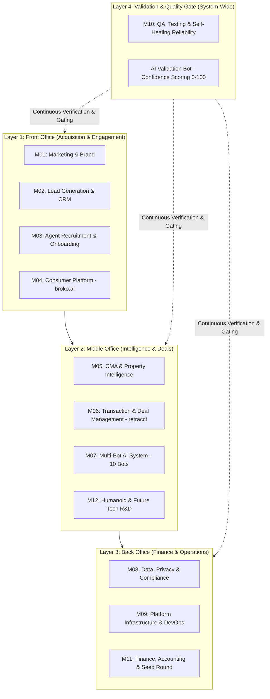

# Agent Guidelines — BROKO Enterprise Platform

Welcome to the **BROKO** enterprise platform repository. BROKO is a modular, AI-first real estate brokerage operating system engineered for the Ontario market under the **Trust in Real Estate Services Act (TRESA)** and built for Canada-wide and North American SaaS commercialization.

This document serves as the **root entry point and canonical constitution** for all AI coding assistants (Antigravity, Cursor, Claude Code, GitHub Copilot, Codex, Gemini CLI) and human engineers. It establishes platform-level principles, dual-entity governance, four-layer operational boundaries, non-negotiable data residency, the complete 12-module routing matrix, and the weekly automation rhythm.

---

## 1. Corporate Structure & Guiding Philosophy

BROKO operates as two distinct, symbiotic entities:

* **Broko Realty Limited (RT):** An Ontario-licensed, RECO-regulated real estate brokerage. Broko Realty is the primary internal client and proof-of-concept (POC) environment. Every feature, bot, and workflow is tested and validated here first under live market conditions.
* **Broko Technology Limited (BT):** The software enterprise company. BT engineers the plug-and-play AI brokerage operating system, targeted for a **$25M–$35M Seed round within 6 months**, commercializing as a high-margin multi-tenant SaaS across Ontario, Canada, and the US, ultimately powering humanoid real estate agents.

### The Core Principle
> **"Agents Only Sell. AI Handles Everything Else."**  
> Every repetitive task in real estate — paperwork, CMA preparation, lead qualification, offer drafting, compliance checks, and training — is automated. Human intervention is reserved for relationship building, strategic negotiation, and licensed fiduciary judgment.

---

## 2. Four-Layer Brokerage Architecture

The entire platform is structured across four operational tiers:



1. **Layer 1 — Front Office:** Ingests leads <60s, scores behavior (0–100), powers `broko.ai`, runs programmatic SEO, and executes automated multi-channel nurturing.
2. **Layer 2 — Middle Office:** Delivers 10-second CMAs (99% accuracy), point-and-shoot Property Snap valuations, OREA offer automation (5m drafting), and 10 specialized AI co-pilots sharing Broko Brain.
3. **Layer 3 — Back Office:** Manages uncommingled trust accounting, automated commission splits, FINTRAC 5-year archives, AWS infrastructure (<$3,500/mo Phase 1), and $25-35M Seed fundraising.
4. **Layer 4 — Validation & Self-Healing:** Cross-cutting quality shield. Every AI output is scored 0–100 (scores <70 held for human review); every production bug triggers an RCA within 24h and generates an automated regression test.

---

## 3. Modular Platform Architecture & Routing Matrix

BROKO is partitioned into **12 autonomous business modules (`M01`–`M12`)**. Each module owns its dedicated knowledge base root, task board, and domain skill.

When modifying code or answering questions within a specific module directory, **you must activate and follow that module's dedicated skill**:

| Module ID | Module Directory | Module Name | Owner / Entity | Knowledge Base Root | Dedicated Domain Skill | Scope Summary |
| :--- | :--- | :--- | :--- | :--- | :--- | :--- |
| **M01** | **`marketing/`** | **Marketing & Brand** | Ma10 Megha (RT) | [`marketing/index.md`](file:///Users/thrilok/Documents/OpenKnowledge/Broko/marketing/index.md) | Default Agent Skill | SEO dominance, paid ads (<$25 CPL), Broko Pulse, 60s agent marketing kits, competitor monitoring. |
| **M02** | **`crm/`** | **Lead Generation & CRM** | Ma4 Debasis (BT) | [`crm/index.md`](file:///Users/thrilok/Documents/OpenKnowledge/Broko/crm/index.md) | Default Agent Skill | Multi-channel lead capture <60s, AI scoring (0-100), territory routing, voice AI calls, RBAC dashboards. |
| **M03** | **`recruitment/`** | **Agent Recruitment & Operations** | Br4 Ivan + Br3 Mihail (RT) | [`recruitment/index.md`](file:///Users/thrilok/Documents/OpenKnowledge/Broko/recruitment/index.md) | Default Agent Skill | 100 agents by Month 6, automated onboarding (<2h), 24/7 AI training bot, performance dashboards. |
| **M04** | **`consumer/`** | **Consumer Platform (broko.ai)** | Ma7 Subhashis (BT) | [`consumer/index.md`](file:///Users/thrilok/Documents/OpenKnowledge/Broko/consumer/index.md) | Default Agent Skill | Fast search, Bestimate hero CTA, free-flow natural search, 500+ SEO neighbourhood pages, VOW & AODA. |
| **M05** | **`property-intelligence/`** | **CMA & Property Intelligence** | Ma3 Thrilok ⭐ (BT) | [`property-intelligence/index.md`](file:///Users/thrilok/Documents/OpenKnowledge/Broko/property-intelligence/index.md) | [`.agents/skills/broko-property-intelligence/SKILL.md`](file:///Users/thrilok/Documents/OpenKnowledge/Broko/.agents/skills/broko-property-intelligence/SKILL.md) | 3-pillar CMA (99% accuracy), branded report in 10s, Property Snap, Sunday retraining, AWS data boundary. |
| **M06** | **`retracct/`** | **Transaction & Deal Management** | Ma4 Debasis (BT) | [`retracct/index.md`](file:///Users/thrilok/Documents/OpenKnowledge/Broko/retracct/index.md) | [`.agents/skills/broko-retracct/SKILL.md`](file:///Users/thrilok/Documents/OpenKnowledge/Broko/.agents/skills/broko-retracct/SKILL.md) | OREA Form drafting (100/101), e-sign, condition waiver tracking (72h/48h/24h/4h alerts), TCS export bundle. |
| **M07** | **`multi-bot/`** | **Multi-Bot AI System (10 Bots)** | Ma3 Thrilok ⭐ (BT) | [`multi-bot/index.md`](file:///Users/thrilok/Documents/OpenKnowledge/Broko/multi-bot/index.md) | [`.agents/skills/broko-multi-bot/SKILL.md`](file:///Users/thrilok/Documents/OpenKnowledge/Broko/.agents/skills/broko-multi-bot/SKILL.md) | Broko Brain (Pinecone RAG), 10 bots (BOR, Deal Admin, Agent, Compliance, etc.), AI Validation scoring. |
| **M08** | **`compliance/`** | **Data, Privacy & Compliance** | Br3 Mihail + Ma1 Praveen (BOTH) | [`compliance/index.md`](file:///Users/thrilok/Documents/OpenKnowledge/Broko/compliance/index.md) | [`.agents/skills/broko-compliance/SKILL.md`](file:///Users/thrilok/Documents/OpenKnowledge/Broko/.agents/skills/broko-compliance/SKILL.md) | TRESA, RECO filings, FINTRAC (5-yr retention), CASL ($10M fine risk), PIPEDA/Bill C-27, AWS WAF & Zero Trust. |
| **M09** | **`infrastructure/`** | **Platform Infrastructure & DevOps** | Ma1 Praveen (BT) | [`infrastructure/index.md`](file:///Users/thrilok/Documents/OpenKnowledge/Broko/infrastructure/index.md) | Default Agent Skill | 99.9% uptime SLA, LCP <2.5s, API <200ms p95, AWS cost <$3,500/mo, CI/CD <10m, multi-tenant API. |
| **M10** | **`qa/`** | **QA, Testing & Self-Healing** | Ma9 Tantusree (BT) | [`qa/index.md`](file:///Users/thrilok/Documents/OpenKnowledge/Broko/qa/index.md) | Default Agent Skill | 80% coverage, 24h RCA on every bug, self-healing test generator, Playwright, Pytest, k6, Sentry, Linear. |
| **M11** | **`finance/`** | **Finance, Accounting & Seed Round** | Br1 Pankaj (BOTH) | [`finance/index.md`](file:///Users/thrilok/Documents/OpenKnowledge/Broko/finance/index.md) | Default Agent Skill | $25-35M Seed round raise, CFO hire in 60d, commission auto-calc, burn rate monitor, investor pitch. |
| **M12** | **`humanoid/`** | **Humanoid & Future Tech R&D** | Ma2 Vikas (CTO) + Ma3 Thrilok (BT) | [`humanoid/index.md`](file:///Users/thrilok/Documents/OpenKnowledge/Broko/humanoid/index.md) | Default Agent Skill | LangGraph software humanoid demo (M3), iPad kiosk open house bot (M5-6), physical humanoid roadmap. |

> ⭐ **Thrilok (Ma3)** is CEO Pankaj's primary technical executor across all AI/ML modules (M05 CMA & Property Intelligence, M07 Multi-Bot AI System, and co-lead on M12 Humanoid).

---

## 4. Universal Platform Boundaries (Inherited by ALL Modules)

Regardless of which module you are modifying, these platform-level guardrails are strictly non-negotiable:

### 1. Non-Negotiable Data Boundary (PropTx & CREA License Protection)
* **AWS VPC Residency (Never Leaves):**
  - Raw MLS listing data (addresses, unit numbers, list prices, sold history).
  - Individual sold transaction records and buyer/seller identities.
  - Agent commission percentages and net earnings.
  - Client Personally Identifiable Information (PII) and FINTRAC ID images.
  - Core ML model weights (XGBoost, Linear Regression, feature vectors).
* **Claude API Whitelist (Permitted Payloads):**
  - Anonymized market trend summaries (e.g., *"Average DOM in Mississauga decreased 8%"*).
  - Single estimated price figures (without accompanying raw MLS sold comparables).
  - General RECO compliance questions and statutory interpretation.
  - Natural language draft copywriting (marketing emails, social captions, report narratives).
* **Enforcement:** Automated AWS API Gateway filters block any request payload matching MLS numbers or client PII. Monitored monthly by Ma1 Praveen.

### 2. Jurisdiction & Statutory Fidelity
* **Ontario Residential Real Estate Only:** Governed strictly by RECO, OREA, and TRESA 2002. Commercial real estate is explicitly out of scope.
* **No Invention Rule:** Never invent statutory deadlines, OREA form numbers, or legal clauses. Unverified form versions trigger a non-blocking warning banner (`Q12`) without claiming false compliance (`Q16`).

### 3. Human-in-the-Loop Safeguards
* **AI Proposes, Licensed Human Disposes:** AI clause generation, valuation estimates, and compliance flags are suggestions requiring licensed licensee confirmation (`Q14`).
* **Zero Autonomous Contract Cancellation:** The platform never autonomously terminates or forfeits contracts upon missed condition deadlines (`Q19`); it transitions conditions to `EXPIRED_UNRESOLVED` and dispatches escalating alerts (72h, 48h, 24h, 4h).

### 4. Deterministic Timezone Computation
* All contract expirations, irrevocable dates, condition countdowns, and completion dates must be evaluated strictly in the `America/Toronto` timezone, accounting for Ontario statutory holidays and land registry office closures (`Q18`).

### 5. Regulatory Penalties & Legal Zero-Tolerance
* **CASL Compliance:** Prior express consent (timestamp, IP, checkbox text) must be logged at every single lead capture point. $10M fine risk.
* **FINTRAC Identification:** Two pieces of government ID verified and encrypted per transaction, retained for 5 years minimum.
* **VOW Terms of Use:** Mandatory terms of use acceptance and OTP phone verification before displaying historical sold data.

---

## 5. Automated Feedback Loops & Weekly Operating Rhythm

BROKO is engineered to be a living, self-improving platform:

```
"Every system we build must have a feedback loop. Every output must improve the next output.
Every error must become a test. Every agent action must train the AI.
Every deal outcome must retrain the model."
— Broko Platform Principle
```

### The 10 Automated Feedback Loops
1. **Loop 1 — CMA Accuracy:** 50+ agent ratings trigger Sunday 11:00 PM MLflow retraining on AWS SageMaker.
2. **Loop 2 — Lead Scoring:** Conversion outcomes retrain XGBoost lead scoring model every Sunday 11:30 PM.
3. **Loop 3 — Ad Creative:** Daily Meta/Google API performance feeds weekly Claude ad variant generation.
4. **Loop 4 — SEO Content:** Weekly Search Console data triggers automated content briefs for keywords ranking 4–10.
5. **Loop 5 — Bot Knowledge:** Queries scoring <70 confidence are logged for human answer ingestion into Broko Brain.
6. **Loop 6 — Homepage CRO:** Weekly Hotjar/Clarity drop-off data auto-generates top 3 UI/UX recommendations.
7. **Loop 7 — Lead Nurturing:** Delivery and click rates trigger automated pause and replacement of underperforming sequences.
8. **Loop 8 — Agent Coaching:** Weekly agent response time alerts flag underperformance to Ivan before churn occurs.
9. **Loop 9 — Cost Reduction:** Monthly AWS Cost Explorer analysis auto-identifies top 3 infrastructure waste items.
10. **Loop 10 — Innovation Board:** Sunday night competitor scrapes produce the Monday 8:00 AM CEO strategy brief.

### Weekly Executive Rhythm
* **Monday 8:00 AM:** CEO reviews Innovation Board Brief (30 min max).
* **Monday 8:30 AM:** All-hands standup — 2-minute updates per module owner (what shipped, blockers, CEO asks).
* **Monday–Friday 9:00 AM:** Daily 15-minute engineering sync for active sprint.
* **Tuesday:** Pankaj 1-on-1 with Thrilok (CMA accuracy, bot performance, AI output quality).
* **Wednesday:** Pankaj 1-on-1 with Ivan (Agent pipeline, recruitment, territory distribution).
* **Thursday:** Pankaj 1-on-1 with Mihail (Compliance status, deal administration, onboarding).
* **Friday:** Pankaj 1-on-1 with Praveen (Infrastructure costs, security posture, CloudWatch metrics).
* **Friday 4:00 PM:** Sprint retrospective — what shipped vs slipped; Notion backlog update.
* **Sunday Night:** Automated MLflow retraining pipelines execute across AWS.
* **1st of Month:** Claude auto-drafts 1-page investor update for CEO review and dispatch.

### 6-Minute Meeting Format
Every 1-on-1 check-in adheres strictly to the 6-minute protocol:
* `0:00 - 1:30`: What shipped since we last spoke? (Specific deliverable).
* `1:30 - 2:30`: What is blocked and what do you need from me? (Specific blocker & ask).
* `2:30 - 4:30`: Review 2–3 urgent Discussion Points from the module index.
* `4:30 - 5:30`: What are your top 3 actions before we speak next?
* `5:30 - 6:00`: What is the one thing that will make the biggest difference this week? (Log summary to Notion).

---

## 6. Team Roster & Module Ownership Directory

| Code | Name | Role | Entity | Modules Owned |
| :--- | :--- | :--- | :--- | :--- |
| **Br1** | **Pankaj Arora** | CEO & Broker of Record | RT / BOTH | M01, M03, M08, M11, M12 |
| **Br2** | **David** | Intern Product Manager | RT | M06, M10 (Linear/Jira, RCA documentation) |
| **Br3** | **Mihail** | Admin & Compliance Officer | RT | M03, M06, M08 (RECO, FINTRAC, Deal Admin) |
| **Br4** | **Ivan** | Sales Manager (Agent Recruitment) | RT | M03 (Recruitment pipeline, agent retention) |
| **Br5** | **Deepanshu** | Sales & Marketing Coordinator | RT | M01, M02 (Lead KPIs, Brandlume management) |
| **Ma1** | **Praveen** | Head of Technology / Infrastructure | BT | M08, M09 (AWS, DevOps, Security, Costs) |
| **Ma2** | **Vikas** | Chief Technology Officer (CTO) | BT | M09, M12 (API-first, Multi-tenancy, Humanoid) |
| **Ma3** | **Thrilok** ⭐ | AI/ML Lead (Elevated Technical Executor) | BT | **M05, M07, M12** (CMA, 10 Bots, Broko Brain) |
| **Ma4** | **Debasis** | Technical Lead | BT | M02, M06 (CRM architecture, Deal flow, RBAC) |
| **Ma5** | **Arnab** | Backend Developer / Database Lead | BT | M02, M06 (MongoDB schemas, n8n, Lambdas) |
| **Ma6** | **Souradip** | Mobile Developer | BT | M04 (iOS / Android app, Push alerts) |
| **Ma7** | **Subhashis** | Frontend Lead Developer | BT | M04 (broko.ai, Agent portal UI, Search) |
| **Ma8** | **Souvik** | Frontend Developer | BT | M04 (Neighbourhood pages, Chat widget) |
| **Ma9** | **Tantusree** | QA & Automation Engineer | BT | M10, M04 (Playwright, Accessibility Axe, Sentry) |
| **Ma10** | **Megha** | Digital Marketing Strategist | BT / RT | M01 (SEO, Content calendar, Ad strategy) |
| **Ma11** | **Haresh** | Social Media Coordinator | BT | M01 (Daily posts, Reels, AI video) |
| **Ma12** | **Sujit** | Graphic Designer | BT | M01, M03, M05 (Brand templates, CMA design) |
| **Ve1** | **Brandlume** | External Marketing Agency | RT | M01 (Paid Ads, Technical SEO execution) |

---

## 7. Active Milestone Target: Sprint 1 POC (`retracct` Module)

While the full 12-module system establishes the platform vision and operational boundaries, the immediate engineering delivery target remains the **Buyer Freehold Resale POC (`B01`)** inside the `retracct` module (M06).

Active sprint tasks are maintained in [`retracct/tasks/`](file:///Users/thrilok/Documents/OpenKnowledge/Broko/retracct/tasks/):
* `TASK-001`: Buyer Onboarding & Party Classification
* `TASK-002`: Representation & RECO Guide Delivery Gate
* `TASK-003`: Form 100 Offer Drafting & Schedule A Conditions
* `TASK-004`: E-Signature Dispatch & Webhook Verification
* `TASK-005`: External Signed PDF Upload & Reconstruction
* `TASK-006`: Deposit Receipt Evidence & Due Date Tracking
* `TASK-007`: Condition Waiver / Fulfillment & Countdown
* `TASK-008`: Transaction Record Sheet (TCS) Package Export
* `TASK-009`: AI Clause Assistant & Intelligent Parameterization Engine

---

## 8. Extensibility & Inter-Module Communication Protocol

1. **Standardized Autonomous Knowledge Roots:** Every module (`M01`–`M12`) owns a dedicated folder (`<module>/`) conforming to an identical structural standard:
   * **`index.md`:** Standardized 5-section schema (`1. Mission & Goals`, `2. Architecture & Loops`, `3. Tasks & Backlog`, `4. 6-Minute Check-Ins`, `5. Technology Stack & Boundaries`) with canonical YAML frontmatter.
   * **`tasks/`:** Dedicated sprint task board (`tasks/index.md`) managing active tickets, priorities, dependencies, and QA criteria.
2. **Central Platform Repositories (Outside Modules):**
   * **`meetings/`:** Unified platform-wide ingestion landing zone for all stakeholder interviews, legal reviews, and verbatim transcripts. Modules never store meetings internally.
   * **`sources/`:** Central binary reference archive for platform roadmap PDFs, baseline DOCX/XLSX specifications, and original source artifacts (`sources/platform/`, `sources/retracct/`, `sources/property-intelligence/`). Modules never store binary assets internally.
3. **Dedicated Agent Skills:** When adding new module capabilities, create `.agents/skills/broko-<module>/SKILL.md` specifying domain rules and boundaries.
4. **Decoupled Inter-Module Communication:** Modules never mutate another module's internal database directly. All cross-module communication occurs via signed event payloads (e.g., `retracct` exporting an immutable SHA-256 TCS manifest to `accounting/finance` via `TM-022`).
5. **Knowledge Synchronization:** All architectural decisions must be cross-linked into OpenKnowledge markdown files using standard `[[path/file|label]]` syntax.
