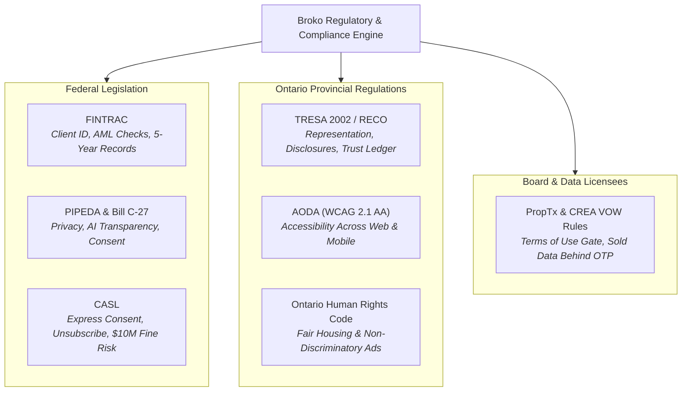

# M08 — Data, Privacy, Legal & Regulatory Compliance

**Module Owners:** Br3 Mihail (Admin & Compliance) & Ma1 Praveen (Head of Technology / Infrastructure)  
**Executive Sponsor:** Br1 Pankaj (CEO & Broker of Record)  
**Entities:** Broko Realty Limited (RT) & Broko Technology Limited (BT)  
**Operational Layer:** Layer 3 (Back Office) & Layer 4 (Validation / Platform Safeguards)  

---

## 1. Module Mission & Compliance Posture

Establish Broko as the **most rigorously compliant real estate technology firm in Canada**. Pass every regulator audit (RECO, FINTRAC, OPCC, CRTC) with zero violations.

> [!CAUTION]
> **Existential Risk Factors:**
> * **CASL Non-Compliance:** Statutory fines up to **$10,000,000 CAD**.
> * **PropTx / CREA Data Breach:** Immediate cancellation of MLS data-feed license, which would permanently shut down `broko.ai`.
> * **FINTRAC Non-Compliance:** Severe criminal penalties, administrative fines, and loss of brokerage operating license.
> * **TRESA Violations:** Immediate RECO disciplinary hearings and loss of Broker of Record status.

---

## 2. Regulatory Frameworks: Statutory Obligations

### Detailed Statutory Rules

1. **FINTRAC (Financial Transactions and Reports Analysis Centre of Canada):**
   * Two pieces of valid government identification verified and recorded prior to submitting or presenting any binding offer.
   * Large cash transaction and suspicious transaction reporting protocols in place.
   * All compliance records must be cryptographically stored and retained for a minimum of **5 years**.
2. **CASL (Canada Anti-Spam Legislation):**
   * Express opt-in consent recorded at every lead capture point (form URL, timestamp, IP address).
   * Functional unsubscribe link in 100% of commercial messages (Email, SMS, WhatsApp).
   * Implied consent strictly tracked with 2-year expiration clocks.
3. **TRESA (Trust in Real Estate Services Act 2002):**
   * RECO Information Guide delivery acknowledged prior to receiving client services.
   * Executed Buyer Representation Agreement (Form 300) or Self-Represented Party Confirmation (Form 320) verified before binding trade negotiations.
   * Trust monies maintained in dedicated, uncommingled trust accounts.
   * Mandatory annual RECO financial filing submission.
4. **PropTx & CREA VOW Display Rules:**
   * Virtual Office Website (VOW) Terms of Use gate required before displaying MLS or historical sold data.
   * Sold transaction data strictly firewalled behind verified user accounts.
   * Raw MLS data must **never** be transmitted outside the secure AWS environment.
5. **AODA (Accessibility for Ontarians with Disabilities Act):**
   * Full conformance with WCAG 2.1 Level AA standards across `broko.ai` and native apps.

---

## 3. Module Tasks & Delivery Backlog

All active sprint tickets are managed on the **[[compliance/tasks/index|M08 Compliance Task Board]]**:

| Ticket ID | Task Name | Owner | Sprint | Priority | Status | Dependencies |
| :--- | :--- | :--- | :--- | :--- | :--- | :--- |
| **`BRK-M08-001`** | **Complete Legal Compliance Framework:** 1-2 day dedicated sprint documenting PIPEDA, TRESA, FINTRAC, CASL, VOW | Br3 Mihail | S1 | 🔴 Critical | Ready | Immediate Priority |
| **`BRK-M08-002`** | **Cybersecurity & Hardening:** AWS WAF + Cloudflare Pro, Zero Trust, MFA enforcement, Secrets Manager, audit logs | Ma1 Praveen | S1 | 🔴 Critical | Ready | M08.1 (Framework documented) |
| **`BRK-M08-003`** | **Proprietary Data Strategy & Governance:** Architecture and compliance protocols for compounding Broko data moat | Br1 Pankaj | S2 | 🟠 High | Backlog | M08.1, M08.2 (Infra live) |

---

## 4. Discussion Points for 6-Minute Check-Ins

1. Is CASL express consent being logged with verifiable proof (IP, timestamp, exact checkbox text) on every lead source?
2. Has FINTRAC ID verification been audited across 100% of active and closed transaction files?
3. Are all production API credentials and database keys residing in AWS Secrets Manager rather than repo configs?
4. Is Multi-Factor Authentication (MFA) strictly enforced across all admin, staff, and agent accounts?
5. Has a formal Privacy Policy review occurred to explicitly disclose automated decision-making and AI processing under PIPEDA?
6. Has the VOW Terms of Use acceptance gate been verified against PropTx data feed requirements?
7. Are MongoDB documents configured with automated TTL deletion schedules consistent with statutory retention periods?
8. Are automated dependency vulnerability scanners (Snyk / npm audit) running in every CI/CD build?

---

## 5. Security & Data Boundary Architecture

* **Web Application Firewall:** AWS WAF + Cloudflare Pro preventing scraping, DDoS, and SQL injection.
* **Encryption Standards:** AES-256 encryption at rest on MongoDB Atlas and AWS S3 buckets; TLS 1.3 in transit.
* **Zero Trust Access:** Least-privilege IAM roles; segregated VPC subnets; no public database endpoints.
* **Auditability:** Complete immutable CloudTrail, Sentry, and API Gateway transaction logs retained for 7 years.
