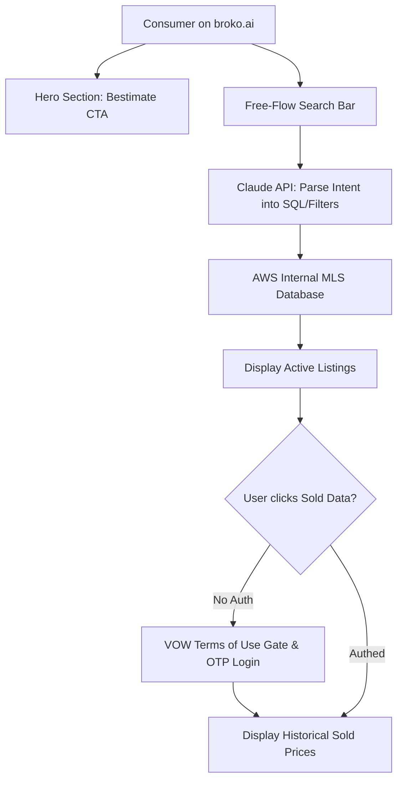

# M04 — Consumer Platform — broko.ai

**Module Owner:** Ma7 Subhashis (Frontend Lead)  
**Contributing Team:** Ma4 Debasis (Technical Lead), Ma6 Souradip (Mobile Developer), Ma8 Souvik (Frontend Developer), Ma9 Tantusree (QA & Accessibility), Ma3 Thrilok (AI Free-Flow Search)  
**Entity:** Broko Technology Limited (BT)  
**Operational Layer:** Layer 1 (Front Office)  

---

## 1. Module Mission & 6-Month Goals

Build the **#1 consumer real estate portal in Ontario** at `broko.ai` and on mobile (iOS/Android). Deliver the fastest property search, the most accurate instant valuation (*Bestimate*), conversational natural language search, and 100% regulatory compliance.

* **Speed & Performance:** Sub-2.5 second Largest Contentful Paint (LCP) globally; compress 3840px hero images to WebP (<200KB).
* **Homepage CRO:** Position Bestimate as the primary hero CTA with prominent above-the-fold lead capture.
* **Natural Language Property Search:** Support intuitive queries (*"3 bed house near good schools in Oakville under $900K"*) with >90% relevance.
* **Programmatic SEO:** Deploy 500+ auto-generated neighbourhood landing pages using Next.js SSG and MLS data feeds.
* **Immediate Risk Mitigation (Day 1):** Remove legacy Re/Max branding from footer; enforce mandatory VOW Terms of Use gate before showing sold or MLS data.
* **Accessibility:** Full WCAG 2.1 Level AA / AODA compliance across web and mobile.

---

## 2. Feedback & Self-Learning Loops

### 🔄 Loop 6 — Homepage Conversion Optimisation
* **Trigger:** Weekly Hotjar heatmaps, session recordings, and Google Analytics / Clarity drop-off data.
* **Action:** Claude analyzes friction points and drop-offs → generates top 3 UI/UX refinements → Subhashis implements and tracks A/B test results.
* **Output:** Continuous improvement in visitor-to-lead conversion rate.
* **Owner & Cadence:** Ma7 Subhashis reviews weekly; automated analysis.

### 🔄 Free-Flow Search Parsing Refinement
* **Trigger:** Unresolved or low-result natural language search queries logged anonymously.
* **Action:** Claude query parser analyzed weekly by Thrilok to identify terminology gaps (e.g. Ontario architectural terms, school zones).
* **Output:** Steadily declining zero-result query rates.
* **Owner & Cadence:** Ma3 Thrilok monitors query failure rate weekly.

---

## 3. Module Tasks & Delivery Backlog

All active sprint tickets are managed on the **[[consumer/tasks/index|M04 Consumer Task Board]]**:

| Ticket ID | Task Name | Owner | Sprint | Priority | Status | Dependencies |
| :--- | :--- | :--- | :--- | :--- | :--- | :--- |
| **`BRK-M04-001`** | **Homepage CRO & Hero Redesign:** Bestimate as primary CTA, above-fold capture, WebP compression, mobile nav fix | Ma7 Subhashis | S1 | 🔴 Critical | Ready | None (Immediate Week 1) |
| **`BRK-M04-002`** | **VOW Compliance & Footer Branding Fix:** Gate sold data behind login/ToU, purge Re/Max branding, FINTRAC notices | Ma4 Debasis | S1 | 🔴 Critical | Ready | None (Legal Risk Today) |
| **`BRK-M04-003`** | **Natural Language Free-Flow Search:** Complete QA with 100+ Ontario test queries, AWS MLS parsing, production rollout | Ma7 Subhashis | S1 | 🔴 Critical | Ready | M04.1 (Homepage stable) |
| **`BRK-M04-004`** | **500+ Programmatic Neighbourhood Pages:** Next.js SSG, local stats, school scores, auto-updating MLS data | Ma4 Debasis | S2 | 🟠 High | Backlog | M04.1 (Stable), M04.3 (Search) |
| **`BRK-M04-005`** | **Floating 24/7 AI Chat Widget:** Lead qualification bot, app download badges, instant valuation teaser | Ma4 Debasis | S2 | 🟠 High | Backlog | M07 (Customer Bot live) |
| **`BRK-M04-006`** | **Full AODA / WCAG 2.1 AA Compliance:** Screen reader testing, keyboard navigation, contrast audit via Axe in CI/CD | Ma9 Tantusree | S2 | 🔴 Critical | Backlog | M04.1 (Fixes complete) |

---

## 4. Discussion Points for 6-Minute Check-Ins

1. Has the Re/Max branding been completely purged from the footer and copyright string?
2. Is the VOW Terms of Use gate strictly enforced before any sold listing data or price history is displayed?
3. What is the current mobile bounce rate and Google PageSpeed LCP score?
4. What percentage of free-flow natural language search queries return accurate property listings?
5. What are the top 5 failed search terms users typed this week?
6. What is the status of the 500+ programmatic neighbourhood SEO pages?
7. Is the AI chat widget live and capturing off-hours leads without breaking page load speed?
8. What is the iOS and Android app rating, and what are top mobile user complaints?
9. Has Tantusree completed the Axe DevTools accessibility audit, and are all issues prioritized?
10. Are sold prices and property comparables properly firewalled behind user OTP phone verification?

---

## 5. Technology Stack & Regulatory Architecture

* **Frontend & Mobile Stack:** Next.js (SSG/SSR), React Native (iOS/Android), Tailwind CSS, Firebase Cloud Messaging (push alerts), Microsoft Clarity / Hotjar.
* **Compliance & Legal Mandates:**
  * **PropTx VOW Rules:** Mandatory Terms of Use acceptance and consumer registration before displaying sold data. Sold data must never be exposed to public crawlers.
  * **AODA (Accessibility for Ontarians with Disabilities Act):** WCAG 2.1 Level AA compliance is legally mandated in Ontario; Axe automated scanning integrated into CI/CD.
