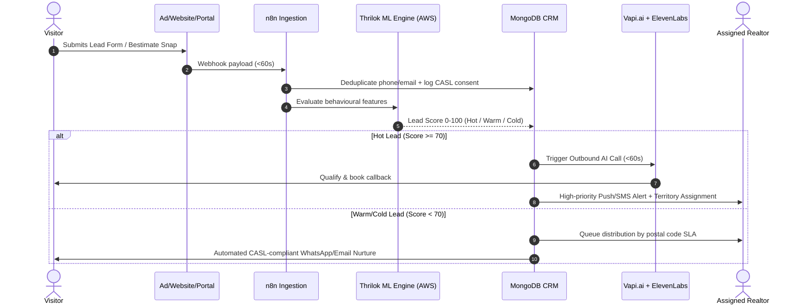

# M02 — Lead Generation & CRM

**Module Owner:** Ma4 Debasis (Technical Lead)  
**Contributing Team:** Ma5 Arnab (Backend / MongoDB), Ma3 Thrilok (AI/ML Lead Scoring), Br4 Ivan (Sales Manager), Br5 Deepanshu (Sales & Marketing)  
**Entity:** Broko Technology Limited (BT)  
**Operational Layer:** Layer 1 (Front Office)  

---

## 1. Module Mission & 6-Month Goals

Deliver a zero-leakage, real-time CRM pipeline where **every lead is captured within 60 seconds**, scored by AI (0–100), distributed intelligently to the right agent, and nurtured automatically with zero manual entry required from ad click to agent conversation.

* **Speed-to-Lead:** <60-second capture from all channels into MongoDB Atlas.
* **Predictive AI Scoring:** Real-time scoring using XGBoost + Redis, categorizing leads into Hot (70+), Warm (40–69), and Cold (<40).
* **AI Voice Calls for Hot Leads:** Immediate outbound conversational AI call via Vapi.ai and ElevenLabs to qualify and book agent callbacks.
* **Role-Based Views:** 5 distinct RBAC dashboards (Admin, Team Lead, Realtor, Accounting, Reception) enforced at the API layer.
* **Continuous Self-Learning:** Sunday night automated retraining pipeline on lead conversion outcomes.
* **Legal Shield:** Verifiable CASL consent logged at every entry point.

---

## 2. Feedback & Self-Learning Loops

### 🔄 Loop 2 — Lead Scoring Improvement
* **Trigger:** New lead conversion outcomes logged in CRM (`converted = 1.0`, `lost = 0.0`, `in-progress`).
* **Action:** MLflow pipeline retrains XGBoost scoring model every Sunday night on AWS SageMaker with new outcome and behavioural data.
* **Output:** Updated model weights deployed to Redis cache; higher lead-to-showing and lead-to-transaction conversion rates.
* **Owner & Cadence:** Ma3 Thrilok monitors model drift weekly; runs automatically.

### 🔄 Loop 7 — Lead Nurturing Optimisation
* **Trigger:** Weekly delivery, open, click, and reply rates across WhatsApp (Wati.io), email (Mailchimp), and SMS (Twilio).
* **Action:** Underperforming sequences automatically paused → Claude generates new messaging variants → A/B tested against control.
* **Output:** Compounding engagement rates and shortened lead qualification cycles.
* **Owner & Cadence:** Ma5 Arnab monitors delivery and engagement metrics weekly; runs automatically.

---

## 3. Module Tasks & Delivery Backlog

All active sprint tickets are managed on the **[[crm/tasks/index|M02 CRM Task Board]]**:

| Ticket ID | Task Name | Owner | Sprint | Priority | Status | Dependencies |
| :--- | :--- | :--- | :--- | :--- | :--- | :--- |
| **`BRK-M02-001`** | **Multi-Channel Lead Auto-Flow:** Website forms, Meta Ads API, Google Ads API feeding CRM <60s with deduplication | Ma4 Debasis | S1 | 🔴 Critical | Ready | M04 (Website live) |
| **`BRK-M02-002`** | **AI Lead Scoring Engine:** Score 0–100, classify Hot/Warm/Cold, portal vs unverified tiers via XGBoost & Redis | Ma3 Thrilok | S1 | 🔴 Critical | Ready | M02.1 (Lead capture live) |
| **`BRK-M02-003`** | **Intelligent Lead Distribution:** Auto-routing by territory, property type, price, agent availability with SLA timer | Ma4 Debasis | S1 | 🔴 Critical | Ready | M02.2 (Lead scoring live) |
| **`BRK-M02-004`** | **Behaviour-Triggered AI Nurturing:** Automated WhatsApp/SMS/Email sequences (Wati.io, Twilio) + CASL audit log | Ma5 Arnab | S2 | 🟠 High | Backlog | M02.3 (Lead distribution live) |
| **`BRK-M02-005`** | **RBAC CRM Dashboards:** Role-specific portals for Admin, Team Lead, Realtor, Accounting, Reception | Ma4 Debasis | S1 | 🔴 Critical | Ready | M02.1–M02.3 (Core pipeline live) |
| **`BRK-M02-006`** | **AI Voice Bot for Hot Leads:** 60-second outbound call via Vapi.ai + ElevenLabs to qualify and book agent callback | Ma3 Thrilok | S3 | 🟠 High | Backlog | M02.2 (Scoring live), M07 (Bot system) |

---

## 4. End-to-End Workflow: Ad Click to Agent Handoff

---

## 5. Technology Stack & Compliance Boundaries

* **Core Stack:** MongoDB Atlas, Redis (real-time scoring cache), AWS SageMaker (XGBoost lead scoring), MLflow, n8n, Vapi.ai, ElevenLabs, Wati.io (WhatsApp Business API), Twilio (SMS), Mailchimp.
* **Compliance & Data Privacy:**
  * **CASL (Canada Anti-Spam Legislation):** Express consent timestamp, IP address, and form URL recorded at capture. Unsubscribe links mandatory in every sequence. Violation exposes firm to fines up to $10M.
  * **PIPEDA:** Lead data stored encrypted at rest (AES-256) in Canada central AWS region.
  * **CRTC Requirements:** Outbound voice AI must identify itself transparently as an automated assistant.
