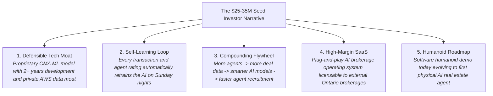

# M11 — Finance, Accounting & Seed Round Fundraising

**Module Owner:** Br1 Pankaj (CEO & Broker of Record)  
**Contributing Team:** Br3 Mihail (Bookkeeping & Trust Ledger), Fractional/Incoming CFO, Ma2 Vikas (CTO), Ma3 Thrilok (AI Demo Lead)  
**Entities:** Broko Realty Limited (RT) & Broko Technology Limited (BT)  
**Operational Layer:** Layer 3 (Back Office) & Executive Governance  

---

## 1. Module Mission & Financial Milestones

Secure a **$25M–$35M Seed Round within 6 months** to fund Canadian expansion and tech leadership. Institute institutional-grade financial governance, automate commission calculations to the cent, and execute a flawless investor pitch strategy.

* **Target Capital:** $25M–$35M Seed round at venture-scale valuation within 6 months (pre-seed round closed).
* **Critical Executive Hire:** Appoint a Chief Financial Officer (CFO) or senior Financial Controller within **60 days**. Institutional VCs will not commit capital without professional financial governance.
* **Accounting Automation:** Automate agent commission splits, deductions, referral fees, and QuickBooks Online syncing upon deal closure.
* **Burn Rate Governance:** Real-time visibility into actual vs budgeted monthly burn rate; automated CEO alerts on expenditure surges.

---

## 2. The 5-Point Investor Narrative & Demo Sequence

### The Investor Demo Sequence (Rehearsed to Flawlessness)

1. **Step 1 — The 60-Second CMA Wow Moment:** Thrilok/Vikas demonstrates live generation of a branded, accurate CMA report with comparables in under 10 seconds.
2. **Step 2 — Real-Time Compliance Bot:** Querying BOR Bot on complex TRESA compliance scenarios with instant section citations.
3. **Step 3 — 5-Minute Offer Preparation:** Auto-filling OREA Form 100 with Schedule A conditional clauses staged for agent review.
4. **Step 4 — Voice AI Lead Call:** Live audio demonstration of Vapi.ai + ElevenLabs calling an inbound lead within 60 seconds of form submission.
5. **Step 5 — Software Humanoid Journey:** LangGraph orchestration simulating a complete, multi-step buyer journey end-to-end.

---

## 3. Module Tasks & Delivery Backlog

All active sprint tickets are managed on the **[[finance/tasks/index|M11 Finance Task Board]]**:

| Ticket ID | Task Name | Owner | Sprint | Priority | Status | Dependencies |
| :--- | :--- | :--- | :--- | :--- | :--- | :--- |
| **`BRK-M11-001`** | **Financial Controls & CFO Recruitment:** Commission tracking, burn rate monitoring, P&L generation, hire CFO in 60d | Br1 Pankaj | S1 | 🔴 Critical | Ready | M02.5 (CRM live for deal data) |
| **`BRK-M11-002`** | **$25-35M Seed Round Execution:** Investor deck, DocSend data room, financial model, 20+ VC meetings | Br1 Pankaj | S2 | 🔴 Critical | Backlog | M05.1 (CMA), M07.2 (BOR Bot), Traction |

---

## 4. Discussion Points for 6-Minute Check-Ins

1. Has the executive search for the CFO / Financial Controller been initiated with tier-1 recruiters?
2. What is our exact monthly burn rate across engineering, marketing, cloud, salaries, and office overhead?
3. What is our current Gross Commission Income (GCI) and total transaction volume closed to date?
4. How many months of runway remain at the current burn trajectory?
5. Is the corporate cap table verified and up-to-date with all pre-seed investors?
6. Are Canadian and US proptech VC target lists compiled with warm introduction pathways?
7. Is the live product demo sequence practiced weekly by Vikas and Thrilok until flawless?
8. Are trust ledger deposits and commission payouts fully reconciled with QuickBooks Online?

---

## 5. Technology Stack & Financial Operations

* **Accounting & General Ledger:** QuickBooks Online (QBO) synced with MongoDB deal transaction records.
* **Investor Relations & Due Diligence:** DocSend (virtual data room with page-by-page engagement analytics), Carta (cap table management).
* **Automated Reporting:** Claude API auto-compiles monthly investor updates (burn rate, GCI, agent count, software milestones) for CEO review.
