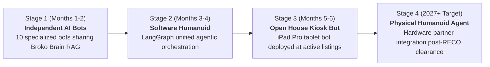

# M12 — Humanoid & Future Tech R&D

**Module Owners:** Ma2 Vikas (CTO) & Ma3 Thrilok (AI/ML Lead)  
**Regulatory Monitoring:** Br3 Mihail (Compliance) & Br1 Pankaj (CEO & BOR)  
**Entity:** Broko Technology Limited (BT)  
**Operational Layer:** Layer 2 (Intelligence) & Next-Generation Hardware/Software  

---

## 1. Module Mission & Evolutionary Roadmap

Pioneer the transition from multi-bot software agents to the **world's first physical AI real estate agent**. The Broko API layer is the humanoid brain; each underlying specialized bot represents one cognitive capability. As the bots mature, LangGraph orchestrates them into a unified software humanoid, transitioning to physical on-site presence as provincial regulations permit.

---

## 2. Key Initiatives & Architecture

### 1. Software Humanoid v1 (Month 3–4 Investor Demo)
* **Unified LangGraph Brain:** Orchestrates BOR Bot, Agent Bot, Customer Bot, and CMA Engine under a single natural persona.
* **Autonomous Buyer Journey:** Ingests buyer criteria, parses MLS properties, runs valuation checks, generates OREA draft offers, and schedules human agent review without hand-off latency.
* **Low-Latency Synthesis:** Sub-1.5 second conversational voice responses using Vapi.ai, ElevenLabs, and FastAPI WebSockets.

### 2. On-Site Open House Tablet Kiosk (Month 5–6 Pilot)
* **Hardware Pilot:** iPad Pro kiosk installed at selected Broko resale and new development listings.
* **Visitor Experience:** Greets incoming open house visitors, guides electronic sign-in, answers property questions (lot specs, school zones, recent neighbourhood comps), and triggers instant SMS summaries to the listing agent.
* **RECO Guardrails:** Explicit on-screen and audio disclosures stating that the kiosk is an automated AI assistant and not a licensed registrant.

### 3. Regulatory Horizon Scanning
* Mihail and Thrilok maintain continuous monitoring of RECO, CREA, and provincial regulatory announcements regarding AI licensing, electronic signatures, and autonomous representation boundaries.

---

## 3. Module Tasks & Delivery Backlog

All active sprint tickets are managed on the **[[humanoid/tasks/index|M12 Humanoid Task Board]]**:

| Ticket ID | Task Name | Owner | Sprint | Priority | Status | Dependencies |
| :--- | :--- | :--- | :--- | :--- | :--- | :--- |
| **`BRK-M12-001`** | **Software Humanoid Multi-Agent System:** LangGraph orchestration unifying all 10 bots into an end-to-end demo | Ma2 Vikas (CTO) | S3 | 🟠 High | Backlog | M07 (All 10 bots live), M09.2 (API-first) |
| **`BRK-M12-002`** | **Open House Tablet Bot & RECO Autonomy Scoping:** iPad kiosk software prototype, visitor registration, regulatory review | Ma3 Thrilok | S4 | 🟠 High | Backlog | M12.1 (Software humanoid v1 working) |

---

## 4. Discussion Points for 6-Minute Check-Ins

1. What is the technical latency breakdown across the LangGraph multi-agent chain (target: <1.5s)?
2. How does the software humanoid preserve conversational memory when a user switches from a buyer to an investor persona?
3. What is the exact persona, tone of voice, and naming convention for the Broko humanoid assistant?
4. What does the physical iPad open house kiosk enclosure and user interface flow look like?
5. What are RECO's exact disclosure requirements when consumers interact with an automated kiosk at an open house?
6. Which hardware robotics firms (e.g. Unitree, Figure, Tesla) are evaluating enterprise software partnerships for real estate?
7. How does the open house bot handle visitors who refuse to provide verified contact details?
8. What fallback mechanism exists if the tablet kiosk loses local WiFi connectivity during a live open house?

---

## 5. Technology Stack

* **Multi-Agent Orchestration:** LangGraph, LangChain, Python FastAPI, WebSockets.
* **Voice & Audio Pipeline:** ElevenLabs (branded voice synthesis), Vapi.ai (conversational telephony and streaming speech-to-text).
* **Hardware Target (Pilot):** iPad Pro, Apple MDM lockdown, kiosk enclosures with cellular backup connectivity.
