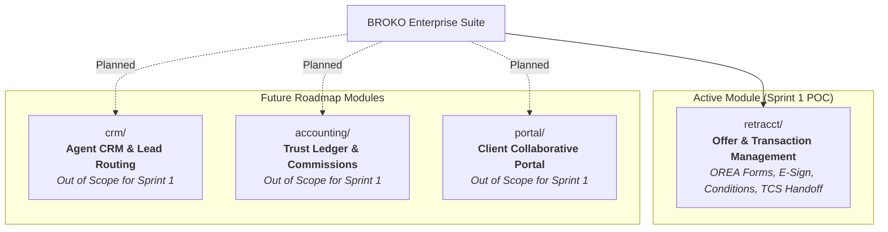

# BROKO — Master Platform Knowledge Base

Welcome to the central knowledge repository for **BROKO**, an enterprise software suite engineered for the Ontario real estate ecosystem under the Trust in Real Estate Services Act (TRESA).

---

## Modular Platform Architecture

BROKO is designed as a modular platform where each business capability is contained in its own dedicated, autonomous module with its own PRD, workflows, compliance guardrails, QA plans, and engineering tasks.

---

## 1. Active Modules

### 🟢 [[retracct/index|retracct — Offer & Transaction Management]]
* **Scope:** Ontario residential transaction and offer management under TRESA.
* **Current Focus:** **Sprint 1 — Buyer Freehold Resale POC (`B01`)**.
* **Key Components:**
  * [[retracct/lifecycle|Software & Knowledge Lifecycle]]
  * [[retracct/tasks/index|Sprint 1 Task Board (TASK-001 to TASK-009)]]
  * [[retracct/01-prd/master-prd|01. Master PRD & Reconciled Decisions (Q01–Q30)]]
  * [[retracct/02-workflows/workflow-catalogue|02. Workflows & State Machines]]
  * [[retracct/03-compliance/engineering-compliance|03. Engineering & Compliance Specs]]
  * [[retracct/04-qa-release/poc-release-plan|04. Release Plan & QA Strategy]]
  * [[retracct/05-matrices/decision-register|05. Traceability Registers & Matrices]]
  * [[retracct/meetings/index|Meetings Hub & Transcripts]]
* **Dedicated Skill:** [`.agents/skills/broko-retracct/SKILL.md`](file:///Users/thrilok/Documents/OpenKnowledge/Broko/.agents/skills/broko-retracct/SKILL.md)

---

## 2. Planned Modules (Roadmap)

| Module Directory | Functionality | Status | Integration Boundary |
| --- | --- | --- | --- |
| `retracct/` | Offer drafting, e-signatures, conditions, deposit proof, TCS compilation | **Active (Sprint 1)** | Delivers completed TCS package (`TM-022`) |
| `crm/` | Lead capture, marketing automation, contact CRM | Planned | Handoffs qualified buyer/seller to `retracct/` |
| `accounting/` | Brokerage trust general ledger, commission splits, bank reconciliations | Planned | Consumes immutable TCS packages from `retracct/` |
| `portal/` | Client-facing portal for viewing documents and signing status | Planned | Consumer of firewalled party workspace events |

---

## 3. Multi-Agent & Developer Guidelines

* **Root Agent Rules:** [`AGENTS.md`](file:///Users/thrilok/Documents/OpenKnowledge/Broko/AGENTS.md)
* **Domain Skills:** All agent skills are modularly placed under [`.agents/skills/`](file:///Users/thrilok/Documents/OpenKnowledge/Broko/.agents/skills/). Each skill activates **only** for its specific module to ensure deterministic, focused outputs.
