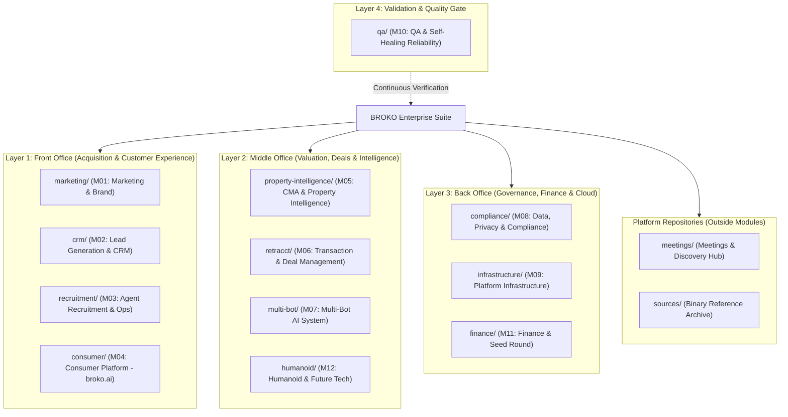

# BROKO — Master Platform Knowledge Base

Welcome to the central knowledge repository for **BROKO**, an enterprise AI real estate platform engineered for the Ontario market under the **Trust in Real Estate Services Act (TRESA)** and built for North American SaaS commercialization.

---

## 1. Modular Platform Architecture (12 Canonical Modules)

BROKO is architectured into 12 autonomous business modules across four operational layers. Every module owns its dedicated knowledge base root, workflows, compliance guardrails, task backlog, and domain skill.

---

## 2. Directory & Module Navigation

### 🟢 Layer 1: Front Office
* [[marketing/index|M01 — Marketing & Brand]]: SEO dominance, paid lead generation (<$25 CPL), Broko Pulse, agent marketing kits, automated competitor analysis.
* [[crm/index|M02 — Lead Generation & CRM]]: Sub-60s multi-channel capture, AI lead scoring (0–100), automated territory routing, outbound voice AI (Vapi.ai + ElevenLabs), RBAC dashboards.
* [[recruitment/index|M03 — Agent Recruitment & Operations]]: 30 agents Month 2 / 100 agents Month 6, automated digital onboarding (<2h), 24/7 self-serve AI training bot.
* [[consumer/index|M04 — Consumer Platform (broko.ai)]]: Sub-2.5s LCP, Bestimate hero CTA, conversational natural language search, 500+ programmatic neighbourhood SEO pages, VOW & AODA compliance.

### 🟢 Layer 2: Middle Office
* [[property-intelligence/index|M05 — CMA & Property Intelligence]]: Core ML IP (XGBoost + Linear Regression), 99% accuracy target, 10-second branded CMA report, [[property-intelligence/snap-feature-prd|Property Snap Feature]], Sunday night MLflow retraining.
* [[retracct/index|M06 — Transaction & Deal Management (retracct)]]: **Active Sprint 1 POC (`B01`)**, OREA Form drafting (100/101), DocuSign integration, condition countdown & alerts (72h/48h/24h/4h), TCS bundle export.
* [[multi-bot/index|M07 — Multi-Bot AI System (10 Bots)]]: Broko Brain (central Pinecone RAG via AWS PrivateLink), 10 specialized bots (BOR, Deal Admin, Agent, Compliance, etc.), AI Validation Bot (0–100 scoring).
* [[humanoid/index|M12 — Humanoid & Future Tech R&D]]: LangGraph multi-agent software humanoid, iPad open house kiosk bot, physical humanoid roadmap (target 2027).

### 🟢 Layer 3: Back Office
* [[compliance/index|M08 — Data, Privacy, Legal & Regulatory Compliance]]: PIPEDA, TRESA, FINTRAC (5-yr retention), CASL ($10M fine prevention), PropTx VOW gate, AWS WAF, Zero Trust, Secrets Manager.
* [[infrastructure/index|M09 — Platform Infrastructure & DevOps]]: 99.9% uptime SLA, API p95 <200ms, AWS cost targets (<$3,500/mo Phase 1), prompt caching, CI/CD in <10m, multi-tenant API.
* [[finance/index|M11 — Finance, Accounting & Seed Round]]: $25M–$35M Seed round fundraising, CFO recruitment within 60 days, commission auto-calculation, QuickBooks Online integration.

### 🟢 Layer 4: Validation & Quality Control
* [[qa/index|M10 — QA, Testing & Self-Healing Reliability]]: Mandatory CI/CD gates, 80% automated coverage, 24-hour RCA system, automated test generation from every fixed defect.

### 📁 Platform-Wide Repositories (Outside Modules)
* [[meetings/index|Meetings & Discovery Hub]]: Master landing zone for all team meetings, stakeholder interviews, legal reviews, and verbatim transcripts.
* [[sources/index|Sources & Binary Reference Archive]]: Central catalog for all platform roadmap PDFs, baseline DOCX/XLSX specifications, and original binary source files.

---

## 3. Dedicated Agent Skills & Rules

All AI assistants and contributors must adhere to the platform rules and activate module-specific domain skills:

* **Root Constitution:** [`AGENTS.md`](file:///Users/thrilok/Documents/OpenKnowledge/Broko/AGENTS.md)
* **Transaction Management Skill:** [`.agents/skills/broko-retracct/SKILL.md`](file:///Users/thrilok/Documents/OpenKnowledge/Broko/.agents/skills/broko-retracct/SKILL.md)
* **Property Intelligence Skill:** [`.agents/skills/broko-property-intelligence/SKILL.md`](file:///Users/thrilok/Documents/OpenKnowledge/Broko/.agents/skills/broko-property-intelligence/SKILL.md)
* **Multi-Bot AI System Skill:** [`.agents/skills/broko-multi-bot/SKILL.md`](file:///Users/thrilok/Documents/OpenKnowledge/Broko/.agents/skills/broko-multi-bot/SKILL.md)
* **Compliance & Legal Governance Skill:** [`.agents/skills/broko-compliance/SKILL.md`](file:///Users/thrilok/Documents/OpenKnowledge/Broko/.agents/skills/broko-compliance/SKILL.md)

---

## 4. Current Engineering Target

* **Current Active Sprint Milestone:** **Buyer Freehold Resale POC (`B01`)** inside `retracct/` (M06).
* **Task Board:** [[retracct/tasks/index|Sprint 1 Task Board (TASK-001 through TASK-009)]].
* **Immediate Week 1 Cross-Module Critical Actions:**
  1. Purge legacy Re/Max branding from footer and enforce VOW Terms of Use gate on `broko.ai` (`M04`).
  2. Conduct CMA accuracy audit (12mo sold data MAPE) and enforce AWS VPC data boundary (`M05`).
  3. Initiate executive CFO search within 60 days (`M11`).
  4. Complete CASL and FINTRAC compliance audit (`M08`).
