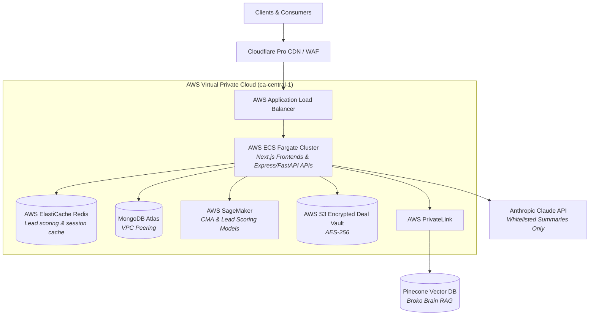

# M09 — Platform Infrastructure & DevOps

**Module Owner:** Ma1 Praveen (Head of Technology / Infrastructure)  
**Contributing Team:** Ma2 Vikas (CTO — Architecture & Multi-Tenancy), Ma4 Debasis (Technical Lead), Ma5 Arnab (Backend)  
**Entity:** Broko Technology Limited (BT)  
**Operational Layer:** Platform Foundation & Cloud Operations  

---

## 1. Module Mission & SLA Targets

Engineer a resilient, highly scalable cloud foundation capable of supporting Broko Realty and external multi-tenant SaaS clients with **99.9% uptime SLA**, sub-200ms API latency, and rigorous financial cost governance.

* **Uptime & Reliability:** 99.9% production availability with automated multi-AZ failover and quarterly disaster recovery drills.
* **Global Performance:** Sub-2.5 second Largest Contentful Paint (LCP) and API p95 latency under 200ms.
* **CI/CD Velocity:** Fully automated GitHub Actions pipeline taking code from commit to production in **under 10 minutes** through automated test gates.
* **API-First & SaaS Readiness:** Architectural decoupling enabling external brokerage multi-tenancy and white-labeling without codebase rewrites.
* **Cost Controls:** Enforce strict monthly cloud spending ceilings.

---

## 2. Infrastructure Financial Targets

| Phase | Timeline | Target Monthly Cap | Primary Cost Levers |
| :--- | :--- | :--- | :--- |
| **Phase 1** | Months 1–2 | **<$3,500 / month** | Claude prompt caching (saves 40–60%), self-hosted n8n/Langfuse/Metabase (saves $1,000/mo), Spot instances for ML. |
| **Phase 2** | Months 3–4 | **<$8,000 / month** | 1-year EC2 Reserved Instances (30–40% discount), S3 Glacier lifecycle tiering, Redis cache hit rate >85%. |
| **Phase 3** | Months 5–6 | **<$15,000 / month** | Scale justified by 100+ active agents and early SaaS pilot revenues. |

### 🔄 Loop 9 — Infrastructure Cost Reduction
* **Trigger:** AWS Cost Explorer and AI API billing data aggregated automatically on the 1st of each month.
* **Action:** Claude analyzes usage spikes and idle resources → identifies top 3 waste items → Praveen executes remediation.
* **Output:** Continuous extension of runway and lower cost per active transaction.
* **Owner & Cadence:** Ma1 Praveen reviews monthly; automated reporting.

---

## 3. Module Tasks & Delivery Backlog

All active sprint tickets are managed on the **[[infrastructure/tasks/index|M09 Infrastructure Task Board]]**:

| Ticket ID | Task Name | Owner | Sprint | Priority | Status | Dependencies |
| :--- | :--- | :--- | :--- | :--- | :--- | :--- |
| **`BRK-M09-001`** | **Production Performance & Monitoring:** CloudWatch dashboard, 99.9% uptime, LCP <2.5s, API <200ms p95, multi-AZ | Ma1 Praveen | S1 | 🔴 Critical | Ready | None (Week 1 Setup) |
| **`BRK-M09-002`** | **Automated CI/CD & API-First Refactor:** Commit-to-prod in <10m, test gates, multi-tenant API spec | Ma4 Debasis | S2 | 🟠 High | Backlog | M10 (QA test suite built) |
| **`BRK-M09-003`** | **Systematic Cost Optimisation:** Claude prompt caching, EC2 Reserved Instances, Spot training, self-hosted tools | Ma1 Praveen | S2 | 🟠 High | Backlog | M09.1 (Monitoring live) |

---

## 4. Discussion Points for 6-Minute Check-Ins

1. What is the exact AWS billing total for the previous month broken down by service (ECS, SageMaker, S3, RDS)?
2. What is our current API p95 response time for search and CMA endpoints?
3. Is prompt caching implemented across all Claude API calls (confirm 40–60% token cost reduction)?
4. Are database migrations strictly segregated from application code deployments in the pipeline?
5. Has the disaster recovery and backup restore process been tested within the last 90 days?
6. Are ML model training jobs running on AWS Spot Instances rather than On-Demand instances?
7. Is CloudWatch actively alerting via SMS/Slack when LCP exceeds 3.0 seconds?
8. Are self-hosted instances of n8n, Langfuse, and Metabase patched and isolated within private subnets?

---

## 5. Technology Stack & Topology

