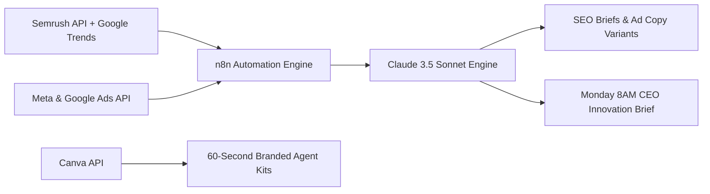

# M01 — Marketing & Brand

**Module Owner:** Ma10 Megha (Digital Marketing Strategist)  
**Contributing Team:** Ve1 Brandlume (Marketing Agency), Ma11 Haresh (Social Media), Ma12 Sujit (Design), Br5 Deepanshu (Sales & Marketing), Br1 Pankaj (CEO)  
**Entity:** Broko Realty Limited (RT)  
**Operational Layer:** Layer 1 (Front Office) & Brand Visibility  

---

## 1. Module Mission & 6-Month Goals

Establish Broko as the **#1 AI real estate brand in Ontario within 6 months** through SEO dominance, paid lead generation, social proof, and agent marketing automation. Every Ontario buyer, seller, and real estate agent must know the Broko name.

* **Lead Volume & Efficiency:** Generate consistent, qualified leads from SEO, paid ads, and social at **under $25 per lead**.
* **Organic Search Authority:** Rank in the top 3 on Google for 20+ high-intent Ontario real estate keywords (e.g., *"Toronto real estate agent"*, *"buy condo Mississauga"*, *"sell home Brampton"*).
* **Thought Leadership:** Build *Broko Pulse* into the go-to publication for Ontario real estate market intelligence.
* **Tech Positioning:** Position Broko as a technology company that does real estate — not just another traditional brokerage.
* **Agent Empowerment:** Auto-generate per-agent branded marketing kits within 60 seconds of onboarding.
* **Competitive Edge:** Automated weekly competitor monitoring (HouseSigma, Zolo, RE/MAX).

---

## 2. Feedback & Self-Learning Loops

### 🔄 Loop 3 — Ad Creative Optimisation
* **Trigger:** Daily ad performance data (CTR, CPC, conversion rate) pulled via Meta/Google Ads API.
* **Action:** Claude analyses performance patterns weekly → generates top 3 new creative variants → Brandlume implements.
* **Output:** Lower cost per lead over time; winning creative patterns learned and replicated.
* **Owner & Cadence:** Br5 Deepanshu reviews weekly vs KPIs; runs automatically.

### 🔄 Loop 4 — SEO Content Improvement
* **Trigger:** Google Search Console rankings and Semrush traffic data pulled weekly.
* **Action:** Claude identifies keywords ranking positions 4–10 (low-hanging fruit) → generates targeted content briefs → Megha approves → Haresh executes.
* **Output:** Compounding organic traffic; top-3 rankings on high-intent Ontario real estate keywords.
* **Owner & Cadence:** Ma10 Megha reviews weekly; automated 7-day loop.

### 🔄 Loop 10 — Innovation Board (CEO Intelligence)
* **Trigger:** Sunday night competitor scrape (Semrush API, Google Trends, Meta Ad Library).
* **Action:** n8n aggregates competitor moves → Claude generates Monday 8:00 AM CEO strategy brief with top 3 priorities.
* **Output:** Executive intelligence delivered to CEO WhatsApp in under 30 minutes reading time.
* **Owner & Cadence:** Br1 Pankaj reviews Monday morning; runs automatically.

---

## 3. Module Tasks & Delivery Backlog

All active sprint tickets are managed on the **[[marketing/tasks/index|M01 Marketing Task Board]]**:

| Ticket ID | Task Name | Owner | Sprint | Priority | Status | Dependencies |
| :--- | :--- | :--- | :--- | :--- | :--- | :--- |
| **`BRK-M01-001`** | **SEO & Content Strategy:** Keyword research, on-page SEO, neighbourhood guides, Broko Pulse, programmatic pages | Ma10 Megha | S1 | 🔴 Critical | Ready | M04.1 (Website stable) |
| **`BRK-M01-002`** | **Paid Ads — Google & Meta:** Google Search/Display + Meta campaigns, AI creative testing, auto-pause rules | Ve1 Brandlume | S1 | 🔴 Critical | Ready | M02.1 (CRM lead capture live) |
| **`BRK-M01-003`** | **Social Media & Brand Content:** Daily posts, reels, agent spotlights, market updates, AI video across platforms | Ma11 Haresh | S1 | 🟠 High | Ready | M01.5 (Brand guidelines complete) |
| **`BRK-M01-004`** | **Agent Marketing Kit Auto-Generation:** Branded templates, listing posts, flyers, email signatures in 60s | Ma12 Sujit | S2 | 🟠 High | Backlog | M03.2 (Agent onboarding live) |
| **`BRK-M01-005`** | **Brand Positioning & Innovation Board Bot:** Weekly AI competitor analysis, sentiment tracking, advisor bot | Br1 Pankaj | S2 | 🟠 High | Backlog | None |

---

## 4. Discussion Points for 6-Minute Check-Ins

1. What leads per month are currently generated from Google, Meta, organic search, and referral?
2. What is our current Cost Per Lead (CPL) and Return on Ad Spend (ROAS) on Google vs Meta?
3. Which keywords are we ranking for, and which high-intent competitor terms are we missing?
4. Is Brandlume following the creative brief accurately, and what are their weekly deliverables?
5. Which social platform drives the highest engagement and verified leads (Instagram, FB, LinkedIn, TikTok)?
6. How quickly does Brandlume respond when a campaign underperforms (target: <24h)?
7. What is our domain authority score compared to HouseSigma and Zolo?
8. Are agent marketing kit templates ready for Canva API automated generation?
9. Are we actively retargeting users who interacted with Bestimate or Property Snap?
10. Should Broko position as a tech company first or a brokerage first in all public marketing?

---

## 5. Technology Stack & Automation Architecture

* **Tools & Stack:** Semrush API, Ahrefs, Claude API (claude-sonnet-4-6), Next.js SSG, n8n (self-hosted), Google Ads API, Meta Ads Manager, Canva API, Buffer, HeyGen, Runway ML.
* **Compliance Guardrails:**
  * Strict RECO advertising guidelines: Brokerage name must be clearly displayed on all advertising; no misleading pricing or claims.
  * CASL compliance: All digital marketing requires verifiable express consent and instant one-click unsubscribe.
