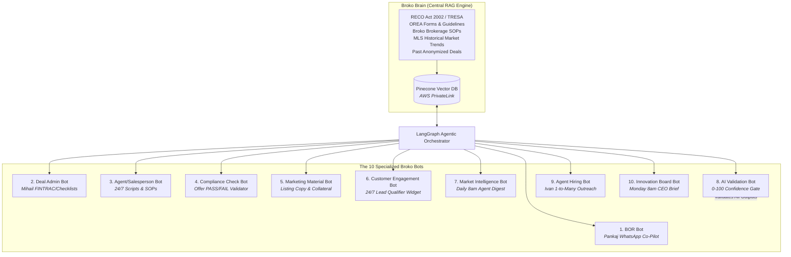

# M07 — Multi-Bot AI System — 10 Bots & Broko Brain

**Module Owner:** Ma3 Thrilok (AI/ML Engineer — **Elevated Role / Primary Technical Executor**)  
**Contributing Team:** Ma2 Vikas (CTO — LangGraph Multi-Agent Orchestration), Br1 Pankaj (CEO & BOR), Br3 Mihail (Compliance), Br4 Ivan (Recruitment), Ma10 Megha (Marketing)  
**Entity:** Broko Technology Limited (BT)  
**Operational Layer:** Layer 2 (Intelligence) & Layer 4 (Validation)  

---

## 1. Module Mission & Architecture

Equip every Broko staff member, agent, and executive with a specialized AI co-pilot available 24/7. All 10 bots operate off a unified central intelligence repository — **Broko Brain** — ensuring deterministic answers, strict source citations, and zero unverified hallucinations.

---

## 2. The 10 Specialized Bots: Detailed Specifications

| Bot # | Bot Name | Primary User | Communication Channel | Core Responsibility & Safeguards |
| :--- | :--- | :--- | :--- | :--- |
| **1** | **Broker of Record (BOR) Bot** | Br1 Pankaj (CEO) | WhatsApp Business API | Instant RECO compliance guidance, disciplinary case precedents, regulatory filings. Cites exact TRESA sections. |
| **2** | **Deal Administrator Bot** | Br3 Mihail (Admin) | Agent Portal / Slack | Automated deal stage checklists, FINTRAC ID completeness checks, deposit reminders. |
| **3** | **Agent/Salesperson Bot** | All Realtors | Mobile App / Web | 24/7 objection handling, pricing strategies, clause suggestions, MLS script coaching. |
| **4** | **Compliance Check Bot** | All Realtors & BOR | Offer Submission Gate | Audits every draft offer (OREA 100/101) before presentation. Emits PASS/FAIL report with statutory citations. |
| **5** | **Marketing Material Bot** | Ma10 Megha & Agents | Web Dashboard | Instantly produces listing descriptions, social captions, flyers, and email blasts from an MLS number. |
| **6** | **Customer Engagement Bot** | Consumers on broko.ai | Website Widget / Chat | 24/7 buyer/seller lead qualification, Bestimate inquiry handling, showing booking assistance. |
| **7** | **Market Intelligence Bot** | All Realtors | Push / Email (Daily 8:00 AM) | Sub-market absorption rates, notable price reductions, and inventory velocity for GTA sub-districts. |
| **8** | **AI Validation Bot** | System-Wide (Layer 4) | Internal API Middleware | Evaluates outputs of bots 1–7 & 9–10. Assigns a confidence score (0–100). Halts outputs scoring <70 for human review. |
| **9** | **Agent Hiring Bot** | Br4 Ivan (Sales Manager) | LinkedIn / Email | Conducts personalized 1-to-many outreach to Ontario licensees; schedules interviews with Ivan. |
| **10** | **Innovation Board Bot** | Br1 Pankaj (CEO) | WhatsApp (Monday 8:00 AM) | Scrapes competitor moves, ad spends, and proptech trends to produce the weekly executive brief. |

---

## 3. Feedback & Self-Learning Loops

### 🔄 Loop 5 — Bot Knowledge Improvement
* **Trigger:** Queries where bot confidence falls below 70% or where human user escalates to BOR/Admin.
* **Action:** Unanswered or low-confidence queries logged to escalation queue → Mihail/Pankaj provide approved answer → New verified Q&A pair embedded into Broko Brain.
* **Output:** Continuous knowledge expansion; reduction in manual human escalation volume.
* **Owner & Cadence:** Br3 Mihail reviews unanswered queue weekly; runs automatically.

### 🔄 Loop 8 — AI Validation Self-Correction
* **Trigger:** Validation failures or detected hallucination patterns flagged by the AI Validation Bot.
* **Action:** Failed outputs converted into regression unit tests in CI/CD; prompt guardrails updated to prevent recurring errors.
* **Output:** Zero duplicate hallucinations across customer or regulatory interactions.
* **Owner & Cadence:** Ma3 Thrilok reviews failure patterns weekly.

---

## 4. Module Tasks & Delivery Backlog

All active sprint tickets are managed on the **[[multi-bot/tasks/index|M07 Multi-Bot Task Board]]**:

| Ticket ID | Task Name | Owner | Sprint | Priority | Status | Dependencies |
| :--- | :--- | :--- | :--- | :--- | :--- | :--- |
| **`BRK-M07-001`** | **Broko Brain RAG Foundation:** Pinecone vector store on AWS PrivateLink; ingest RECO Act, OREA forms, SOPs | Ma3 Thrilok | S2 | 🔴 Critical | Backlog | M08.3 (Data architecture defined) |
| **`BRK-M07-002`** | **Executive & Admin Bots:** Deploy BOR Bot (WhatsApp) and Deal Admin Bot (FINTRAC/checklists) | Ma3 Thrilok | S2 | 🔴 Critical | Backlog | M07.1 (Broko Brain live) |
| **`BRK-M07-003`** | **Field & Acquisition Bots:** Deploy Agent Assistant Bot, Compliance Check Bot, and Hiring Bot | Ma3 Thrilok | S2 | 🔴 Critical | Backlog | M07.1 (Brain live), M03.2 (Onboarding) |
| **`BRK-M07-004`** | **Customer & Content Bots:** Deploy Marketing Bot, 24/7 Consumer Chat Widget, and Market Digest Bot | Ma3 Thrilok | S3 | 🟠 High | Backlog | M07.1 (Brain live), M04.5 (Chat widget) |
| **`BRK-M07-005`** | **AI Validation & Executive Intelligence:** Deploy AI Validation Bot (0-100 scoring) and Innovation Board Bot | Ma3 Thrilok | S3 | 🔴 Critical | Backlog | M07.1–M07.4 (All bots active) |

---

## 5. Technology Stack & Multi-Agent Orchestration

* **Core Infrastructure:** Pinecone Vector Database (hosted on AWS PrivateLink for enterprise security), LangChain, LangGraph (stateful multi-agent execution), Langfuse (self-hosted telemetry, hallucination monitoring, and cost tracking).
* **LLM Foundation:** Claude 3.5 Sonnet (claude-sonnet-4-6) via Anthropic API (non-sensitive reasoning and conversation synthesis).
* **Telemetry & Cost Tracking:** Self-hosted Langfuse records latency, token spend, prompt caching hit rate, and confidence scores for every single bot completion.
