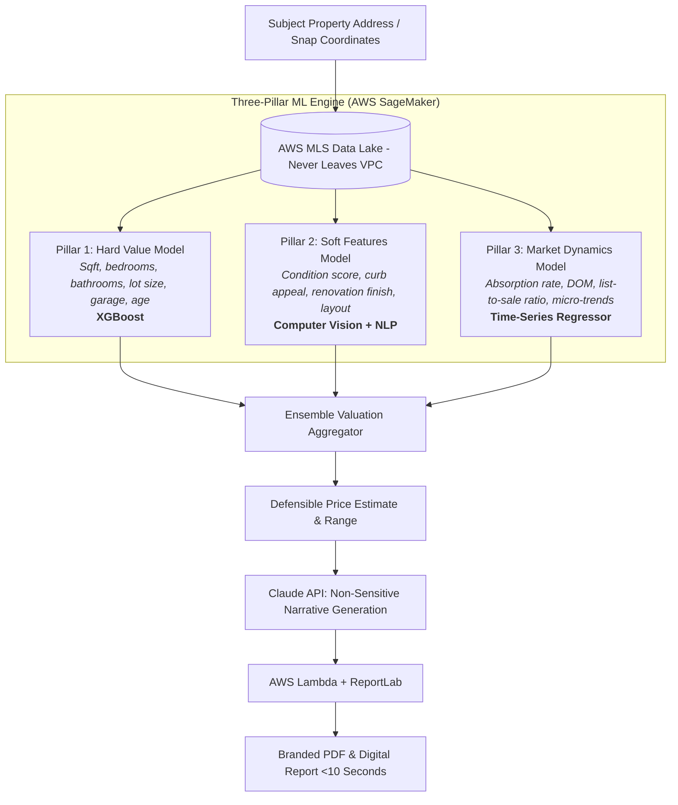

# M05 — CMA & Property Intelligence

**Module Owner:** Ma3 Thrilok (AI/ML Engineer — **Elevated Role / Primary Technical Executor**)  
**Contributing Team:** Ma1 Praveen (Data Boundary & Infrastructure), Ma4 Debasis (Alerts & CRM Integration), Ma12 Sujit (Report Design), Br1 Pankaj (CEO & BOR)  
**Entity:** Broko Technology Limited (BT)  
**Operational Layer:** Layer 2 (Middle Office) & Core IP  

---

## 1. Module Mission & Core Intellectual Property

Build the **most accurate, fastest Comparative Market Analysis (CMA) and valuation engine in Ontario**, hitting **99% accuracy (MAPE <2%)** within 6 months. Transform a painful 2- to 3-hour manual agent research task into a **10-second branded presentation report**.

> [!IMPORTANT]
> **Defensible Core IP & Tech Moat:**
> The Broko CMA engine represents 2+ years of proprietary machine learning development combining Linear Regression, XGBoost, and proprietary feature engineering. All model weights, features, and sold training data **remain strictly inside the AWS VPC**. They are never shared externally.

### The Three-Pillar Valuation Architecture



1. **Pillar 1: Hard Value (Physical Specs):** Direct feature contribution from square footage, bedroom/bath counts, lot dimensions, basement finish, and structure age.
2. **Pillar 2: Soft Features (Qualitative Elements):** Quantified scoring of finishes, renovation tier, curb appeal, streetscape, and natural light.
3. **Pillar 3: Market Analysis (Velocity & Trends):** Real-time adjustments based on sub-neighbourhood inventory absorption rates, days on market (DOM), and list-to-sale price variance.

---

## 2. Key Features

### 1. Branded 10-Second CMA Report (`BRK-M05-002`)
* Generates an investor-grade, agent-branded digital and PDF report in <10 seconds.
* Automatically includes 3–5 optimal comparables, market narrative, and price probability band.

### 2. Bestimate — Consumer Instant Valuation
* Public-facing valuation CTA on `broko.ai` driving high-intent seller and buyer leads.
* VOW-compliant disclosure and tiering (general range teaser pre-verification; comps behind OTP).

### 3. Property Snap Feature
* Point-and-shoot camera feature allowing consumers and agents to snap any residential property and instantly retrieve its Bestimate, specs, and status.
* Full PRD documented in [[property-intelligence/snap-feature-prd|Snap Feature PRD]].

### 4. Renovation Cost & ROI Estimator (`BRK-M05-006`)
* Itemized renovation cost benchmarks calibrated for Greater Toronto Area (GTA) labour and material pricing.
* Displays estimated property valuation uplift before and after planned renovations.

---

## 3. Feedback & Self-Learning Loops

### 🔄 Loop 1 — CMA Accuracy Improvement
* **Trigger:** 50+ agent ratings (thumbs up/down + variance notes) on generated CMAs.
* **Action:** MLflow automated pipeline triggers Sunday night at 11:00 PM → evaluates model against held-out Ontario test set → auto-deploys updated weights if MAPE improves.
* **Output:** Continuous week-over-week error reduction. Target: Baseline → <5% Month 4 → <2% (99% accuracy) Month 6.
* **Owner & Cadence:** Ma3 Thrilok reviews weekly accuracy report; runs automatically.

### 🔄 Closed Deal Retraining Loop
* **Trigger:** Every completed real estate transaction closing in Ontario MLS.
* **Action:** Actual sale price compared against historical AI pre-listing prediction to log error deltas and retrain weighting vectors.
* **Output:** Broko AI becomes exponentially smarter in active neighbourhoods than static valuation tools.

---

## 4. Module Tasks & Delivery Backlog

All active sprint tickets are managed on the **[[property-intelligence/tasks/index|M05 Property Intelligence Task Board]]**:

| Ticket ID | Task Name | Owner | Sprint | Priority | Status | Dependencies |
| :--- | :--- | :--- | :--- | :--- | :--- | :--- |
| **`BRK-M05-001`** | **CMA Model Audit & Accuracy Sprint:** Audit 3 model pillars vs 12mo sold data, calculate MAPE by property type | Ma3 Thrilok | S1 | 🔴 Critical | Ready | Immediate Week 1 Priority |
| **`BRK-M05-002`** | **Branded PDF & Digital Report Generator:** 10-second generation via AWS Lambda & ReportLab | Ma3 Thrilok | S1 | 🔴 Critical | Ready | M05.1 (Accuracy acceptable) |
| **`BRK-M05-003`** | **Strict Data Boundary Enforcement:** VOW/MLS sold data stays in AWS VPC; Claude receives non-sensitive summaries | Ma1 Praveen | S1 | 🔴 Critical | Ready | Non-negotiable Week 1 Gate |
| **`BRK-M05-004`** | **Real-Time Property & Price Alerts:** Notifications within 5m of MLS change; load tested for 1,000 concurrent | Ma4 Debasis | S1 | 🔴 Critical | Ready | M05.1 (CMA), M02.1 (CRM) |
| **`BRK-M05-005`** | **Agent Rating System & Sunday Retraining:** Thumbs up/down UI in portal triggering MLflow Sunday pipeline | Ma3 Thrilok | S2 | 🔴 Critical | Backlog | M05.2 (CMA reports live) |
| **`BRK-M05-006`** | **AI Renovation Estimator & Neighbourhood Stats:** GTA cost calculator + HoodQ/WalkScore school & transit metrics | Ma3 Thrilok | S2 | 🟠 High | Backlog | M05.2 (CMA reports live) |

---

## 5. Non-Negotiable Data Boundary

```
+------------------------------------------------------------------------+
|                          AWS VPC (NEVER LEAVES)                        |
|                                                                        |
|  * Raw MLS listing records (addresses, unit numbers, list prices)       |
|  * Historical sold transaction prices and closing dates               |
|  * Agent commission rates and net payout data                          |
|  * Client Personally Identifiable Information (PII)                    |
|  * FINTRAC identification documents                                    |
|  * Core ML weights and XGBoost feature trees                           |
+------------------------------------------------------------------------+
                                    |
                                    | Whitelisted Anonymized Summaries Only
                                    v
+------------------------------------------------------------------------+
|                      EXTERNAL AI (CLAUDE API)                          |
|                                                                        |
|  * Anonymized market trend summaries ("Avg DOM up 12% in Oakville")     |
|  * Single price estimate number (no raw comparable transaction rows)   |
|  * Plain-English narrative drafting for report sections                |
|  * Regulatory and general compliance logic checks                       |
+------------------------------------------------------------------------+
```

* **Enforcement:** Enforced at AWS API Gateway level with regex blocking on PII, MLS numbers, and exact address strings. Thrilok maintains the explicit whitelist.
