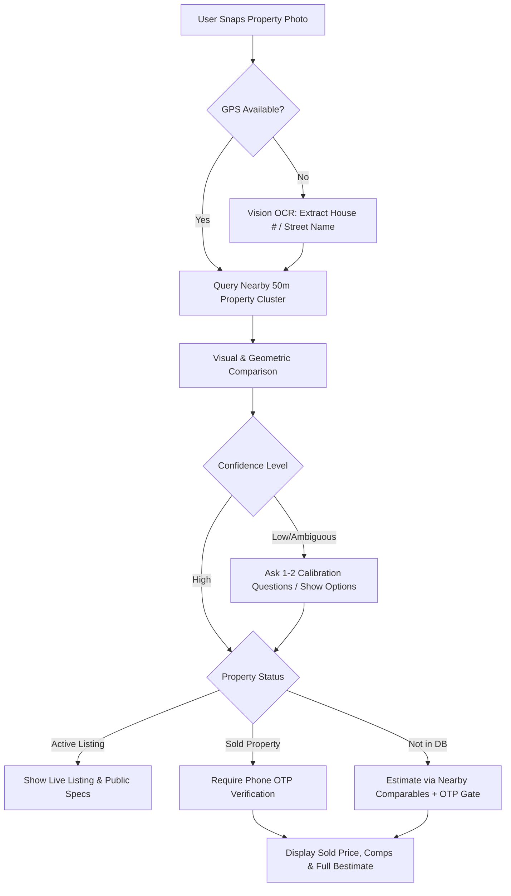

# Property Snap Feature — Preliminary Product Requirements

**Document Version:** v0.4  
**Status:** Internal Team Discussion  
**Module:** [[property-intelligence/index|M05 — CMA & Property Intelligence]]  
**Technical Lead:** Ma3 Thrilok  

---

## 1. Executive Overview

**Property Snap** lets a user point their mobile camera at any house, townhouse, or condominium in Ontario and instantly receive Broko's automated value estimate (**Bestimate**) and key property details — eliminating manual address entry or search filtering.

* **UI Placement:** Dedicated camera button situated on the main app navigation, leading directly into the conversational estimate interface.
* **Conversational Format:** Result cards and calibration follow-up questions are presented in Broko's in-app chat framework.

---

## 2. Strategic Rationale & Value Proposition

1. **Top-of-Funnel Viral Hook:** Creates a shareable, talked-about moment that drives curiosity and introduces consumers to Bestimate and the Broko chatbot.
2. **Low-Friction Bridge:** Transforms casual sidewalk interest into qualified platform engagement and potential agent-led advisory conversations.
3. **Continuous Data Accumulation:** Every real-world photo submission provides ground-truth visual data to train property-matching algorithms.

---

## 3. Risk Management & Mitigations

| Risk | Impact | Architecture Mitigation |
| :--- | :--- | :--- |
| **Wrong Property Identified** | Immediate loss of user credibility | High/Medium/Low confidence scoring. When look-alikes exist, display candidate cards. Ask 1–2 calibration questions before rendering value. |
| **No GPS / Harsh Weather** | Failed location lookup | Fall back to OCR of visible street numbers or signs from the image; gracefully prompt retake if obscured by snow, darkness, or vehicles. |
| **Real Estate Board VOW Rules** | Regulatory infraction with PropTx | Basic property identification is public; sold prices, comparables, and the detailed estimate require phone OTP verification per VOW regulations. |
| **Out-of-Coverage Query** | User frustration | Plain-language disclosure that coverage is currently GTA-only; generate comparative estimates from nearest perimeter data. |
| **Scraping / Bulk Misuse** | High cloud compute costs | IP-based rate limiting for anonymous users (~5 snaps); authenticated users receive elevated allowance with backend anomaly tracking. |

---

## 4. High-Level Flow & Decision Paths

---

## 5. Architectural Boundaries for v1

* **In Scope:** Camera capture only, front-facing exterior matching, condominium building identification with unit selection, VOW OTP verification gate.
* **Out of Scope for v1:** Customer photo upload from device camera roll, AI digital removal of cars/obstructions, interior photo matching.
