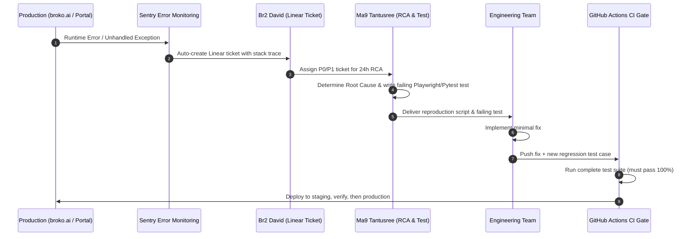

# M10 — QA, Testing & Self-Healing Reliability

**Module Owner:** Ma9 Tantusree (QA Engineer)  
**Contributing Team:** Br2 David (Intern PM — Bug Tracking & RCA Logging), Ma4 Debasis (Technical Lead), Ma7 Subhashis (Frontend Lead)  
**Entity:** Broko Technology Limited (BT)  
**Operational Layer:** Layer 4 (Validation) & Engineering Governance  

---

## 1. Module Mandate & Reliability Targets

Enforce a culture of **zero unstable releases**. Test suites act as an uncompromising, mandatory gate in the CI/CD pipeline. No code reaches production without passing all automated tests.

* **Target Test Coverage:** Achieve **80% automated test coverage** across frontend, backend, and ML endpoints by Month 2.
* **The Self-Healing Law:** Every single production bug triggers a mandatory **Root Cause Analysis (RCA) within 24 hours**. An automated test case must be added to the test suite before the fix is merged.
* **Non-Recurring Defect Guarantee:** The exact same bug cannot reach production twice in the history of the codebase.
* **Accessibility as a CI Gate:** Zero new WCAG 2.1 AA / AODA accessibility regressions allowed through the deployment pipeline.

---

## 2. The Self-Healing Bug Lifecycle

---

## 3. Module Tasks & Delivery Backlog

All active sprint tickets are managed on the **[[qa/tasks/index|M10 QA Task Board]]**:

| Ticket ID | Task Name | Owner | Sprint | Priority | Status | Dependencies |
| :--- | :--- | :--- | :--- | :--- | :--- | :--- |
| **`BRK-M10-001`** | **Comprehensive Automated Test Suite:** Playwright (E2E), Pytest (API/ML), k6 (load), Detox (mobile), Axe (AODA) | Ma9 Tantusree | S1 | 🔴 Critical | Ready | M09.2 (CI/CD pipeline) |
| **`BRK-M10-002`** | **24hr RCA System & Self-Healing Loop:** Every bug logged in Linear → RCA in 24h → regression test generated | Ma9 Tantusree | S1 | 🔴 Critical | Ready | M10.1 (Test suite), Linear |
| **`BRK-M10-003`** | **Production Stability Protocol:** Mandatory pre-release gates, post-deploy smoke tests, instant automated rollback | Ma9 Tantusree | S1 | 🔴 Critical | Ready | M10.1, M09.2 |

---

## 4. Discussion Points for 6-Minute Check-Ins

1. What is the current automated test coverage percentage across the codebase?
2. Are all existing features covered by regression tests before new feature code is written?
3. How many production errors were recorded in Sentry over the past 7 days?
4. Was a formal RCA completed within 24 hours for every reported bug this sprint?
5. How long does the full automated test suite take to run in GitHub Actions (must stay <10 min)?
6. Has the price alert system undergone load testing with 1,000 simultaneous synthetic events?
7. Have Axe accessibility checks caught any WCAG 2.1 AA regressions in active PRs?
8. Does Tantusree hold final veto power on every production release deployment?

---

## 5. Technology Stack & Testing Matrix

* **E2E & Accessibility Testing:** Playwright + Axe DevTools (covers browser flows and automated WCAG 2.1 AA checks).
* **Backend & ML Testing:** Pytest (API contracts, schema validations, XGBoost prediction threshold sanity).
* **Load & Performance Testing:** k6 (load testing search queries, lead ingest webhooks, alert triggers).
* **Mobile App Testing:** Detox (React Native mobile integration flows on iOS/Android emulators).
* **Visual Regression:** Percy (detects unintended UI layout or styling shifts).
* **Error Tracking:** Sentry (real-time error telemetry and sourcemap aggregation).
* **Defect Management:** Linear (strict severity tiers, SLAs, and RCA documentation).
