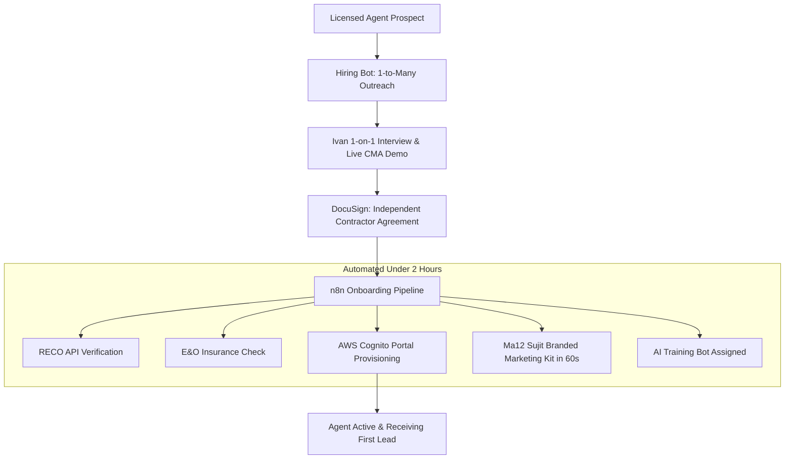

# M03 — Agent Recruitment & Operations

**Module Owners:** Br4 Ivan (Sales Manager / Agent Recruitment) & Br3 Mihail (Admin / Compliance)  
**Contributing Team:** Ma4 Debasis (Technical Lead), Ma3 Thrilok (AI Hiring Bot), Br1 Pankaj (CEO & BOR)  
**Entity:** Broko Realty Limited (RT)  
**Operational Layer:** Layer 1 (Front Office) & Operations  

---

## 1. Module Mission & 6-Month Goals

Scale the brokerage to **30 active agents by Month 2, 50 by Month 3, and 100 by Month 6**. Attract top Ontario licensed agents frustrated with legacy brokerages by offering the ultimate value proposition: *"Agents Only Sell. AI Handles Everything Else."*

* **Primary Recruitment Hook:** Live 10-second CMA generation demo, 5-minute offer drafting, and zero administrative paperwork.
* **Rapid Onboarding:** 100% digital onboarding completing RECO verification, E&O check, platform access, and training in **under 2 hours** (down from 1–2 days).
* **24/7 AI Training Bot:** Real-time answers to RECO compliance, OREA forms, objection handling, and brokerage SOPs.
* **Agent Retention:** Keep annual agent churn below 10% through real-time GCI tracking, transparent leaderboards, and automated coaching alerts.

---

## 2. Feedback & Self-Learning Loops

### 🔄 Loop 8 — Agent Performance Coaching
* **Trigger:** Weekly CRM tracking of agent response times, lead-to-showing ratios, and contract closing rates.
* **Action:** Agents falling below SLA thresholds automatically flagged → Ivan receives a coaching brief with specific diagnostic data → targeted 1-on-1 scheduled.
* **Output:** Underperforming agents receive intervention before churn; top performers highlighted for recruitment referrals.
* **Owner & Cadence:** Br4 Ivan reviews weekly; automated detection.

### 🔄 Hiring Bot Outreach Refinement
* **Trigger:** Weekly response rates, interview conversion, and objections logged from LinkedIn and Meta recruitment campaigns.
* **Action:** Claude refines outreach messaging copy based on agent sentiment and competitor dissatisfaction patterns.
* **Output:** Higher conversion from prospect touch to signed contract.
* **Owner & Cadence:** Br4 Ivan + Ma3 Thrilok; monthly retraining.

---

## 3. Module Tasks & Delivery Backlog

All active sprint tickets are managed on the **[[recruitment/tasks/index|M03 Recruitment Task Board]]**:

| Ticket ID | Task Name | Owner | Sprint | Priority | Status | Dependencies |
| :--- | :--- | :--- | :--- | :--- | :--- | :--- |
| **`BRK-M03-001`** | **Multi-Channel Agent Recruitment:** Targeted LinkedIn, Meta, and direct referral campaigns to Ontario agents | Br4 Ivan | S1 | 🔴 Critical | Ready | M03.2 (Value prop deck & CMA demo) |
| **`BRK-M03-002`** | **Automated Digital Onboarding:** RECO registration check, E&O verification, DocuSign ICA, portal provisioning <2h | Br3 Mihail | S1 | 🔴 Critical | Ready | M05.1 (CMA demo ready) |
| **`BRK-M03-003`** | **Self-Serve AI Training Bot:** 24/7 assistant loaded with RECO Act, OREA forms, scripts, and Broko SOPs | Br3 Mihail | S2 | 🟠 High | Backlog | M07.1 (Broko Brain RAG live) |
| **`BRK-M03-004`** | **Agent Performance & Commission Dashboard:** Real-time GCI, split calculations, leaderboard, inactivity alerts | Ma4 Debasis | S2 | 🟠 High | Backlog | M02.5 (CRM), M11.1 (Commission tracking) |

---

## 4. Discussion Points for 6-Minute Check-Ins

1. What is our current active agent count, and what brokerages are prospects transitioning from?
2. What are the top objections agents raise during interviews (splits, brand awareness, tech confidence)?
3. How do our commission splits and tech subsidies compare to RE/MAX, Century 21, and Royal LePage?
4. What is the actual duration of the current onboarding workflow end-to-end?
5. Are all active agent RECO registration numbers and E&O insurance certificates audited and compliant?
6. Is the live CMA demo polished and ready to showcase to high-producing prospective agents?
7. How is Ivan tracking the recruitment pipeline (Linear, CRM, or spreadsheet)?
8. What is the structured onboarding plan for a new agent's first week at Broko?
9. Are current agents providing feedback on what tools they use most vs what causes friction?
10. Should Broko implement a peer referral bonus structure for agents recruiting other licensed agents?

---

## 5. Technology Stack & Operational Architecture

* **Tools & Stack:** Claude API (Hiring Bot & Training Bot), n8n (onboarding orchestrator), DocuSign / Signwell (ICAs), AWS Cognito (agent portal auth), LinkedIn Sales Navigator, QuickBooks Online (commission ledger).
* **Compliance Guardrails:**
  * Mandatory RECO registration verification prior to any trade in real estate.
  * E&O Insurance verification must remain active at all times.
  * Brokerage-Agent agreements must be stored permanently under RECO record retention regulations.
