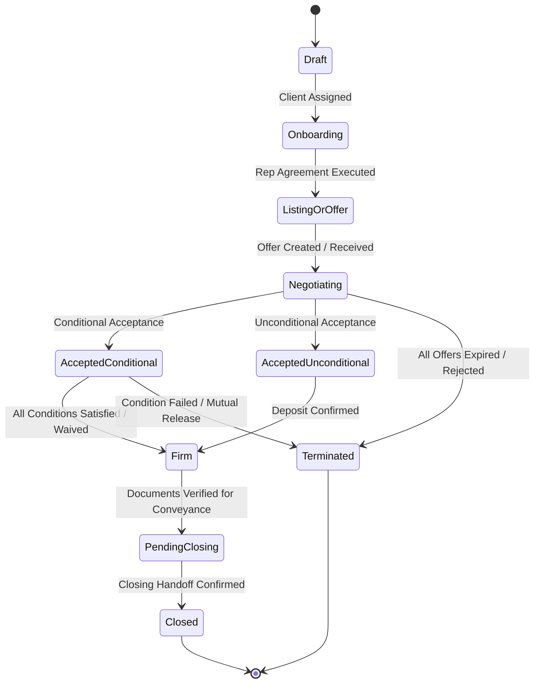
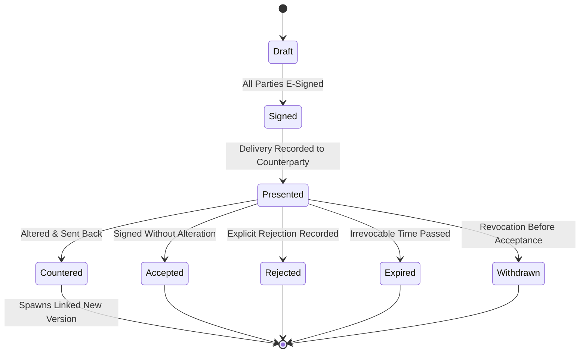
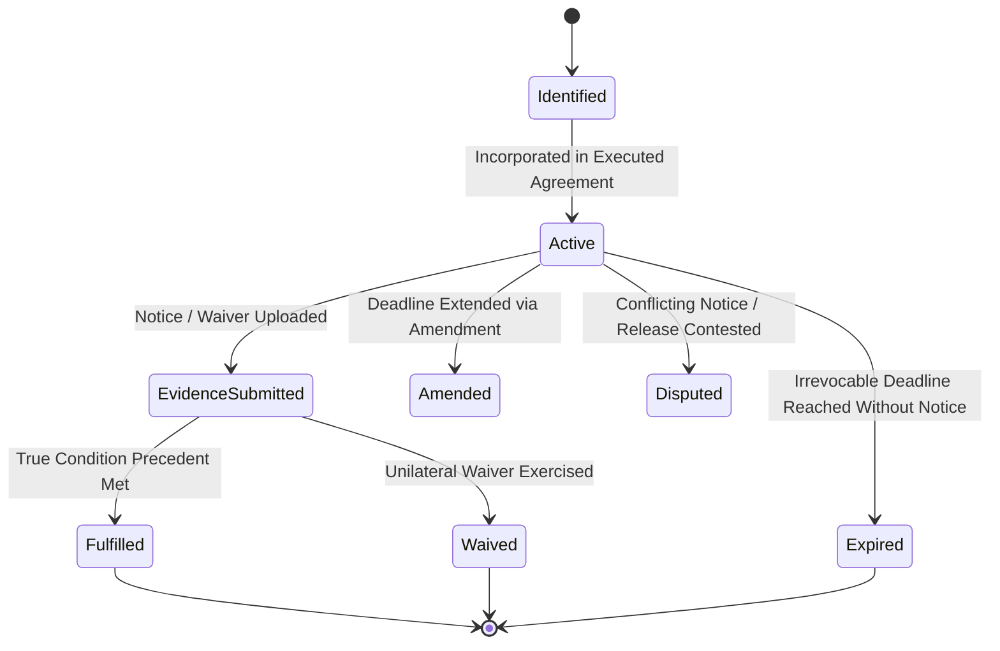
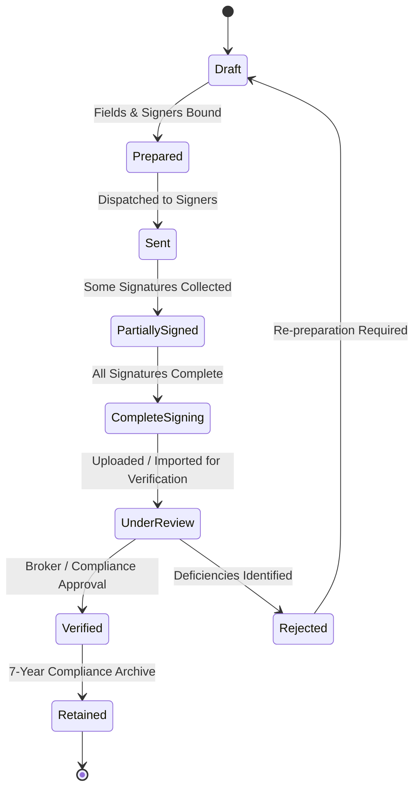
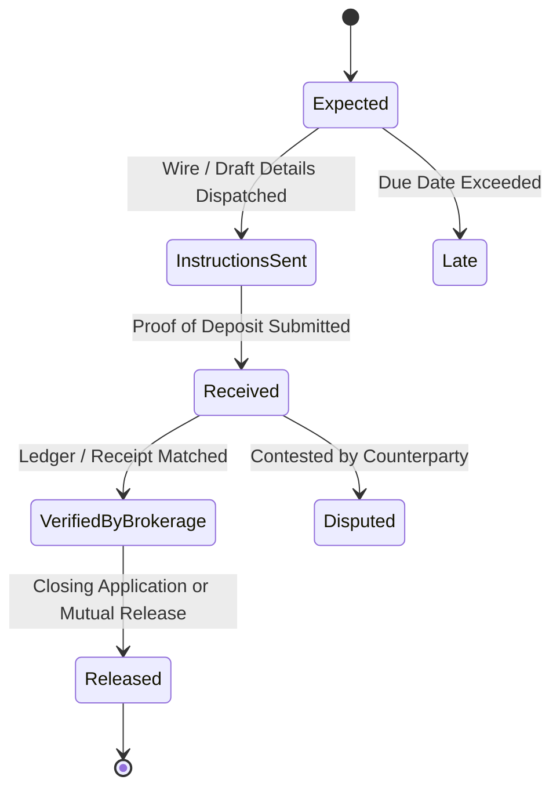

# Interactive State Machines & Domain Lifecycles

BROKO's domain is driven by six core state machines operating with strict event validation.

---

## 1. Transaction State Machine

---

## 2. Offer & Counteroffer State Machine

---

## 3. Condition Lifecycle State Machine

---

## 4. Document Verification State Machine

---

## 5. Deposit Lifecycle State Machine

---
*See [[retracct/03-compliance/engineering-compliance|Engineering Compliance]] for API event contracts driving these states.*
