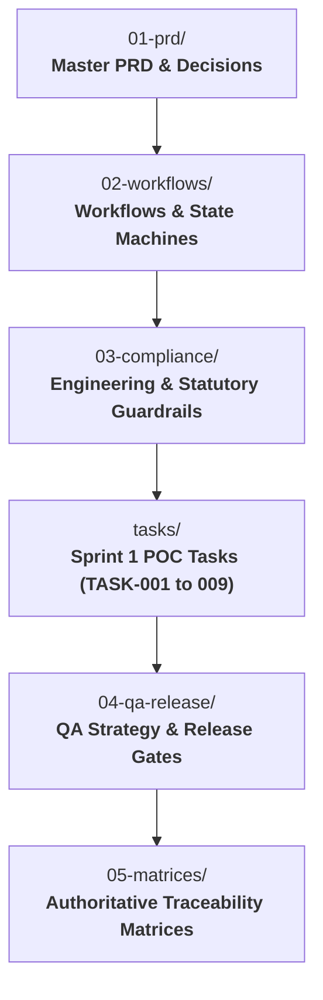

# M06 — Transaction & Deal Management

**Module Owner:** Ma4 Debasis (Technical Lead)  
**Contributing Team:** Br3 Mihail (Admin & Compliance Officer), Br1 Pankaj (Broker of Record), Ma5 Arnab (Backend Lead), Br2 David (Product Intern)  
**Entity:** Broko Technology Limited (BT) / Tested with Broko Realty (RT)  
**Operational Layer:** Layer 2 (Middle Office) — **Active Sprint 1 POC (`B01`) Target**  

---

## 1. Module Mission & Core Scope

Deliver an event-driven, audit-grade transaction and offer management engine engineered specifically for the Ontario residential market under the **Trust in Real Estate Services Act (TRESA 2002)**. Automate the end-to-end deal lifecycle across all four residential journeys: **Buyer**, **Seller**, **Landlord**, and **Tenant**.

* **Active Sprint 1 Delivery Target:** **Buyer Freehold Resale POC (`B01`)** — from client onboarding and representation agreement gating through OREA Form 100 offer drafting, DocuSign execution, deposit tracking, condition waiver countdowns, and Transaction Record Sheet (TCS) compilation.
* **Statutory Compliance:** Strict enforcement of RECO Information Guide delivery prior to advice/services, uncommingled trust deposit tracking (5 business days), and FINTRAC 5-year compliance archiving.
* **Deterministic Timezone:** All condition expirations, irrevocable dates, and completion countdowns calculate strictly in `America/Toronto` timezone, accounting for Ontario statutory holidays and land registry closures.

---

## 2. Architecture & Sub-Modules

The `retracct` module is structured into specialized engineering specifications, interactive state machines, and reference matrices:

### Knowledge Base Navigation
* **[[retracct/01-prd/master-prd|01. Master PRD]]:** Numbered functional requirements (`TM-001`–`TM-030`), operating personas, transaction taxonomy, and [[retracct/01-prd/decisions-reconciled|30 Reconciled Architectural Decisions (Q01–Q30)]].
* **[[retracct/02-workflows/workflow-catalogue|02. Workflows & State Machines]]:** Execution journeys ([[retracct/02-workflows/buyer-workflows|Buyer B01–B07]], [[retracct/02-workflows/seller-workflows|Seller S01–S06]], [[retracct/02-workflows/lease-workflows|Lease L01–L06 & T01–T06]]) and [[retracct/02-workflows/state-machines|Interactive Mermaid State Machines]].
* **[[retracct/03-compliance/engineering-compliance|03. Engineering & Statutory Compliance]]:** Microservice boundaries, REST/Webhook contracts, and [[retracct/03-compliance/regulatory-guardrails|Source-Backed Compliance Guardrails]] and [[retracct/03-compliance/ambiguities-and-resolutions|Open Ambiguities (A-01 to A-12)]].
* **[[retracct/04-qa-release/poc-release-plan|04. Release Plan & QA Strategy]]:** [[retracct/04-qa-release/poc-release-plan|Buyer Freehold POC Release Plan]], test coverage criteria, and [[retracct/04-qa-release/qa-test-plan|QA Test Plan]].
* **[[retracct/05-matrices/decision-register|05. Traceability & Reference Matrices]]:** [[retracct/05-matrices/decision-register|Decision Register]], [[retracct/05-matrices/requirements-matrix|Requirements Matrix (TM-001–TM-030)]], [[retracct/05-matrices/form-and-field-registry|Form & Field Registry]], [[retracct/05-matrices/open-decisions|Open Decisions (A-01–A-12)]], [[retracct/05-matrices/qa-cases|QA Cases (T-001–T-026)]], [[retracct/05-matrices/scenario-catalogue|Scenario Catalogue]], and [[retracct/05-matrices/regulatory-sources|Regulatory Sources]].
* **Engineering Handbooks:** [[retracct/DEVELOPER-GUIDE|Developer Implementation Guide & Prisma Schema]] and [[retracct/lifecycle|Software Development Lifecycle]].

---

## 3. Module Tasks & Delivery Backlog

All active sprint engineering is tracked in the **[[retracct/tasks/index|Sprint 1 Task Board & Kanban]]**:

| Ticket ID | Task Name | Owner | Sprint | Priority | Status |
| :--- | :--- | :--- | :--- | :--- | :--- |
| **`TASK-001`** | [[retracct/tasks/TASK-001-buyer-onboarding\|Buyer Onboarding & Party Classification]] | Debasis / Arnab | S1 | 🔴 Critical | Ready |
| **`TASK-002`** | [[retracct/tasks/TASK-002-representation-agreement\|Representation & RECO Guide Delivery Gate]] | Debasis / Mihail | S1 | 🔴 Critical | Ready |
| **`TASK-003`** | [[retracct/tasks/TASK-003-form-100-drafting\|Form 100 Offer Drafting & Schedule A Conditions]] | Debasis / Thrilok | S1 | 🔴 Critical | Ready |
| **`TASK-004`** | [[retracct/tasks/TASK-004-esign-dispatch-and-webhook\|E-Signature Dispatch & Webhook Verification]] | Debasis / Arnab | S1 | 🔴 Critical | Ready |
| **`TASK-005`** | [[retracct/tasks/TASK-005-signed-pdf-import\|External Signed PDF Upload & Reconstruction]] | Debasis / Arnab | S1 | 🔴 Critical | Ready |
| **`TASK-006`** | [[retracct/tasks/TASK-006-deposit-verification\|Deposit Receipt Evidence & Due Date Tracking]] | Mihail / Debasis | S1 | 🔴 Critical | Ready |
| **`TASK-007`** | [[retracct/tasks/TASK-007-condition-fulfillment\|Condition Waiver / Fulfillment & Countdown]] | Debasis / Mihail | S1 | 🔴 Critical | Ready |
| **`TASK-008`** | [[retracct/tasks/TASK-008-tcs-export\|Transaction Record Sheet (TCS) Package Export]] | Arnab / Mihail | S1 | 🔴 Critical | Ready |
| **`TASK-009`** | [[retracct/tasks/TASK-009-ai-clause-assistant\|AI Clause Assistant & Intelligent Parameterization]] | Thrilok / Debasis | S1 | 🔴 Critical | Ready |

---

## 4. Discussion Points for 6-Minute Check-Ins

1. Has the RECO Information Guide delivery gate (`TASK-002`) been verified to block offer drafting until signed acknowledgement is on record?
2. Are Form 100 Schedule A standard clauses pulling exclusively from the verified clause library without unparameterized placeholders?
3. How are DocuSign envelope webhooks handling out-of-order execution during high-volume counter-offer exchanges?
4. What is the fallback workflow when an external agent uploads a flattened, non-searchable scanned PDF offer (`TASK-005`)?
5. Is the condition countdown alert firing deterministically at exactly 72h, 48h, 24h, and 4h prior to expiration in `America/Toronto`?
6. Does the deposit tracking ledger prevent marking a deal firm if the trust deposit receipt is unverified past the 5th banking day?
7. Is the generated Transaction Record Sheet (TCS) ZIP export SHA-256 hash verified against tampering prior to BOR sign-off?
8. Are all draft offer values encrypted at rest using AWS KMS envelope encryption?
9. Have all 30 architectural decisions (`Q01`–`Q30`) been reflected in the Prisma ORM schema migrations?
10. Is the AI Clause Assistant (`TASK-009`) adhering strictly to the non-negotiable rule that AI proposes while licensed agents dispose?

---

## 5. Technology Stack & Compliance Boundaries

* **Core Stack:** Next.js, Node.js / TypeScript, Prisma ORM, PostgreSQL (immutable append-only audit trail), AWS Lambda, DocuSign eSign API, pdf-lib, Sentry.
* **Compliance Boundaries:**
  * **Zero Autonomous Contract Cancellation:** Expired conditions transition to `EXPIRED_UNRESOLVED` with escalating human alerts; the platform never voids a contract autonomously (`Q19`).
  * **Immutable Audit Trail:** Every field modification, signature event, and status transition is hashed and cryptographically sealed for 5-year FINTRAC retention (`TM-023`).
  * **Original Source Documents:** Archived in [[sources/index|Sources & Binary Reference Archive]] under `sources/retracct/`.
