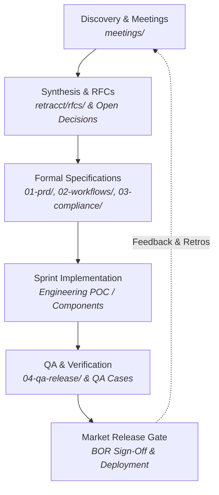

# BROKO Software Development & Knowledge Lifecycle

This document defines the end-to-end lifecycle connecting discovery meetings, legal consultations, and customer feedback to architecture, specifications, engineering implementation, and QA release gates.

---

## 1. Lifecycle Overview

---

## 2. The 5 Lifecycle Stages

### Stage 1: Discovery & Meeting Ingestion
* **Location:** [`meetings/`](file:///Users/thrilok/Documents/OpenKnowledge/Broko/meetings)
* **Purpose:** Ingest stakeholder interviews (Broker of Record, real estate agents, conveyancers), legal reviews (OREA / RECO counsel), and team standups.
* **OpenKnowledge Integration:** Uses the built-in `meeting-note` template (`New Document from Template`).
* **Output:** Documented notes with owners, tagged action items, and wikilinks to impacted matrices or requirements.

### Stage 2: Synthesis & Decision Maturation
* **Location:** [`retracct/05-matrices/open-decisions`](file:///Users/thrilok/Documents/OpenKnowledge/Broko/retracct/05-matrices/open-decisions) & [`retracct/rfcs/`](file:///Users/thrilok/Documents/OpenKnowledge/Broko/retracct/rfcs)
* **Purpose:** Resolve controlled ambiguities (`A-01` through `A-12`) and debate architectural trade-offs before writing production code.
* **Output:** Approved design resolutions recorded in the [[retracct/05-matrices/decision-register|Decision Register]].

### Stage 3: Formal Specification & Domain Modeling
* **Location:**
  * [[retracct/01-prd/master-prd|01-prd/]] — Numbered functional requirements (`TM-001` to `TM-030`).
  * [[retracct/02-workflows/workflow-catalogue|02-workflows/]] — Journeys (`B01`–`B07`, `S01`–`S06`, `L01`–`L06`, `T01`–`T06`) & [[retracct/02-workflows/state-machines|State Machines]].
  * [[retracct/03-compliance/engineering-compliance|03-compliance/]] — API contracts and statutory guardrails.
* **Output:** Verified, immutable versioned specifications.

### Stage 4: Implementation & Sprints
* **Current Focus:** **Buyer Freehold Resale POC (`B01`)**
* **Work Items:**
  1. Transaction onboarding and party classification
  2. Representation agreement tracking (OREA 300 / RECO guide)
  3. Offer preparation (OREA Form 100 + Schedule A)
  4. E-signature dispatch and external signed PDF import
  5. Deposit status tracking and condition fulfillment
  6. Transaction Record Sheet (TCS) package compilation

### Stage 5: Verification & Release Gating
* **Location:** [[retracct/04-qa-release/poc-release-plan|04-qa-release/]]
* **Verification:** Every deliverable must pass its associated test cases in [[retracct/05-matrices/qa-cases|QA Cases (T-001 to T-026)]].
* **Release Gate:** Formal sign-off on security, double-representation firewall penetration testing, and BOR compliance attestation.

---

## 3. Meeting-to-Specification Routing Matrix

When a meeting takes place, use this routing table to push updates to the right artifact:

| Discussion Topic | Ingestion Target | Action Required |
| --- | --- | --- |
| Legal / OREA Form Changes | [[retracct/05-matrices/form-and-field-registry|Form & Field Registry]] | Update version status or mapping |
| Architectural Conflict / Trade-off | [[retracct/05-matrices/open-decisions|Open Decisions]] | Update resolution status or risk score |
| Feature Request / Refinement | [[retracct/05-matrices/requirements-matrix|Requirements Matrix]] | Add / amend `TM-xxx` requirement |
| Workflow Edge Case / Exception | [[retracct/02-workflows/workflow-catalogue|Workflow Catalogue]] | Add guard rule or exception trigger |
| Bug / Test Failure / Audit Gap | [[retracct/05-matrices/qa-cases|QA Cases]] | Add / update `T-xxx` test case |
